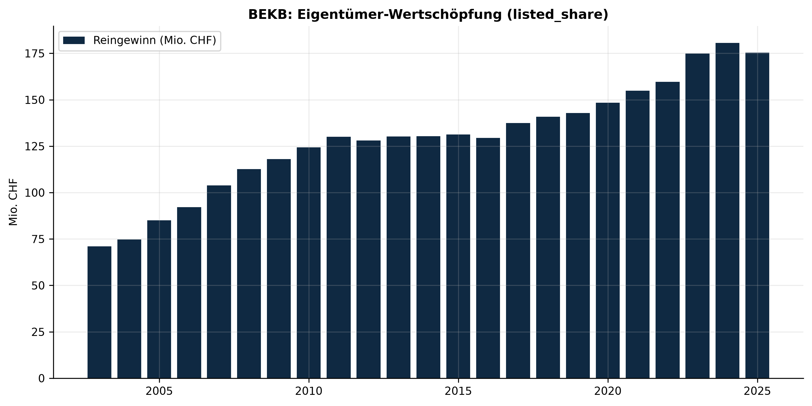

# 05 · Aktie, Dividenden & Wertschöpfung (2003–2025): Berner Kantonalbank AG

> **Eigentümer-Modus:** `listed_share` | **Staatsgarantie:** Keine | **Ticker:** `BEKN`

## 1. Management Summary
- Im Geschäftsjahr 2025 erwirtschaftete BEKB einen Gewinn von **175,4 Mio. CHF** bei einem Eigenkapital von **– Mio. CHF**.
- Die Ausschüttungs- und Kapitalstruktur folgt dem spezifischen Governance-Modell (`listed_share`).

## 2. Quantitative Entwicklung
| Jahr | Reingewinn (Mio.) | Eigenkapital (Mio.) | Aktienkurs (split-ber.) | Dividende/Aktie | Div.-Rendite | Öff. Ablieferung (Mio.) |
| --- | --- | --- | --- | --- | --- | --- |
| 2003 | 71,1 | – | – | 3.00 | – % | – |
| 2004 | 74,7 | – | – | 0.00 | – % | – |
| 2005 | 85,0 | – | – | 3.50 | – % | – |
| 2006 | 92,2 | – | – | – | – % | – |
| 2007 | 103,8 | – | – | 3.50 | – % | – |
| 2008 | 112,7 | – | – | – | – % | – |
| 2009 | 118,0 | – | – | – | – % | – |
| 2010 | 124,4 | – | – | 5.10 | – % | – |
| 2011 | 130,1 | – | – | 5.30 | – % | – |
| 2012 | 128,1 | – | – | 5.30 | – % | – |
| 2013 | 130,1 | – | – | 5.50 | – % | – |
| 2014 | 130,4 | – | – | 5.80 | – % | – |
| 2015 | 131,3 | – | – | 6.00 | – % | – |
| 2016 | 129,4 | – | – | 6.20 | – % | – |
| 2017 | 137,4 | – | – | 6.60 | – % | – |
| 2018 | 140,8 | – | – | 6.20 | – % | – |
| 2019 | 142,9 | – | – | 8.40 | – % | – |
| 2020 | 148,4 | – | – | 8.80 | – % | – |
| 2021 | 154,9 | – | – | 9.20 | – % | – |
| 2022 | 159,6 | – | – | 9.60 | – % | – |
| 2023 | 174,9 | – | – | 10.00 | – % | – |
| 2024 | 180,7 | – | – | 10.40 | – % | – |
| 2025 | 175,4 | – | – | 10.80 | – % | – |

## 3. Treiberanalyse & Wendepunkte
- Bei kotierten Instituten mit Aktiensplits (z. B. BCV 1:10 im Jahr 2020) sind sämtliche historischen Kurs- und Dividendenreihen deterministisch split-bereinigt.

## 4. Fazit & Ausblick
- Stabile Ertragskraft sichert langfristig Dividendenkontinuität bzw. verlässliche Ablieferungen an Kanton, Post oder Genossenschafter.
