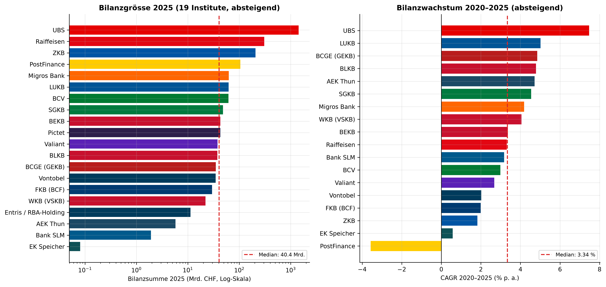
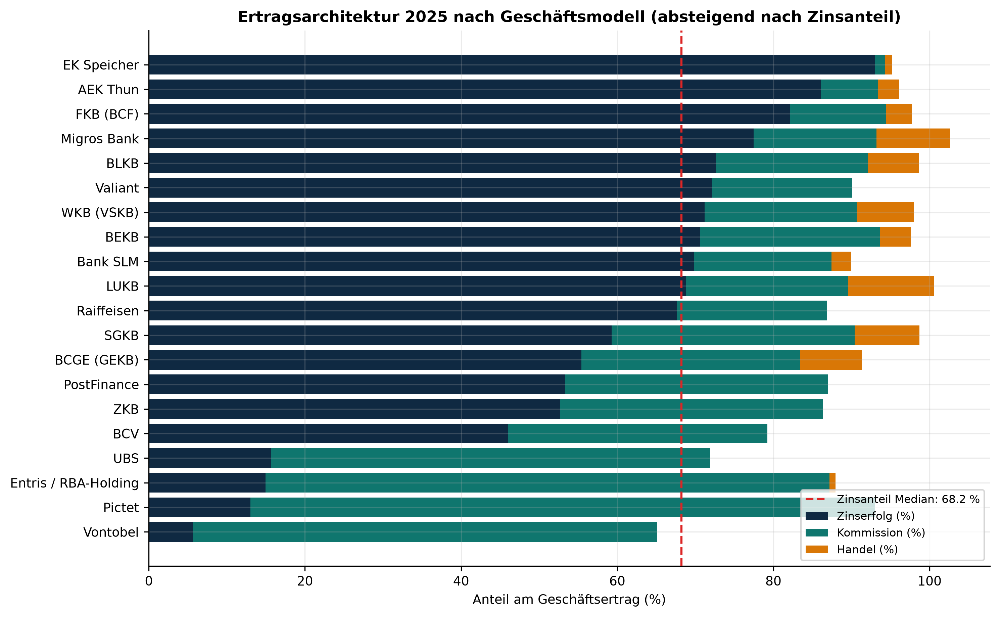

# 01 · Grösse, Wachstum & Geschäftsmodell (20 Schweizer Banken)

> **Harmonisierung:** Alle Werte in **Mio. CHF** (UBS USD→CHF via `shared/fx_rates.py`). Vergleichbarkeitshinweise zu `consolidated`/`standalone` und `ARB_RVB`/`IFRS` sind pro Zeile ausgewiesen.

## 1. Management Summary
- Die Bilanzsummen 2025 spannen über vier Grössenordnungen: von regionalen Sparkassen und Kantonalbanken über die inländischen D-SIBs (**PostFinance, ZKB, Raiffeisen**) bis zum globalen G-SIB **UBS**.
- **Geschäftsmodelle im Kontrast:** Klassische Kantonalbanken, Regionalbanken & Raiffeisen erzielen **55–93 %** ihres Ertrags im Zinsgeschäft; **UBS, Pictet & Vontobel** dominieren über Wealth-Management-Kommissionen; **PostFinance** investiert aufgrund des gesetzlichen Kreditverbots in Finanzanlagen statt Hypotheken.

## 2. Quantitative Gegenüberstellung (Geschäftsjahr 2025)
| Institut | Peer Group | Scope | Standard | Bilanzsumme 2025 (Mio.) | CAGR 20–25 | Zinsanteil | Komm.-Anteil |
| --- | --- | --- | --- | --- | --- | --- | --- |
| BEKB | cantonal_bank | standalone | ARB_RVB | 42'977,0 | 3,37 % | 70,6 % | 23,0 % |
| WKB (VSKB) | cantonal_bank | standalone | ARB_RVB | 22'042,2 | 4,06 % | 71,2 % | 19,5 % |
| ZKB | cantonal_bank | consolidated | ARB_RVB | 206'177,0 | 1,82 % | 52,7 % | 33,7 % |
| BCV | cantonal_bank | consolidated | ARB_RVB | 61'620,0 | 2,99 % | 46,0 % | 33,2 % |
| BCGE (GEKB) | cantonal_bank | consolidated | ARB_RVB | 34'905,0 | 4,85 % | 55,4 % | 28,0 % |
| Raiffeisen | domestic_dsib | consolidated | ARB_RVB | 305'611,0 | 3,31 % | 67,6 % | 19,3 % |
| PostFinance | domestic_dsib | standalone | ARB_RVB | 104'836,0 | -3,57 % | 53,3 % | 33,7 % |
| UBS | g_sib | consolidated | IFRS | 1'426'570,6 | 7,47 % | 15,6 % | 56,3 % |
| EK Speicher | regional_bank | standalone | ARB_RVB | 80,7 | 0,58 % | 93,0 % | 1,3 % |
| Bank SLM | regional_bank | standalone | ARB_RVB | 1'913,9 | 3,18 % | 69,9 % | 17,6 % |
| AEK Thun | regional_bank | standalone | ARB_RVB | 5'744,1 | 4,71 % | 86,1 % | 7,3 % |
| Migros Bank | regional_bank | standalone | ARB_RVB | 62'327,6 | 4,19 % | 77,5 % | 15,7 % |
| Vontobel | wealth_manager | consolidated | IFRS | 34'737,0 | 2,03 % | 5,7 % | 59,5 % |
| Pictet | private_bank | consolidated | ARB_RVB | 42'928,1 | – % | 13,0 % | 80,0 % |
| Entris / RBA-Holding | regional_bank | consolidated | ARB_RVB | 11'247,9 | – % | 14,9 % | 72,2 % |
| Valiant | regional_bank | consolidated | ARB_RVB | 37'874,1 | 2,68 % | 72,1 % | 17,9 % |
| SGKB | cantonal_bank | consolidated | ARB_RVB | 48'136,6 | 4,54 % | 59,3 % | 31,1 % |
| LUKB | cantonal_bank | consolidated | ARB_RVB | 62'249,1 | 5,02 % | 68,8 % | 20,7 % |
| BLKB | cantonal_bank | consolidated | ARB_RVB | 37'614,0 | 4,79 % | 72,6 % | 19,5 % |
| FKB (BCF) | cantonal_bank | standalone | ARB_RVB | 29'482,3 | 1,99 % | 82,1 % | 12,3 % |

