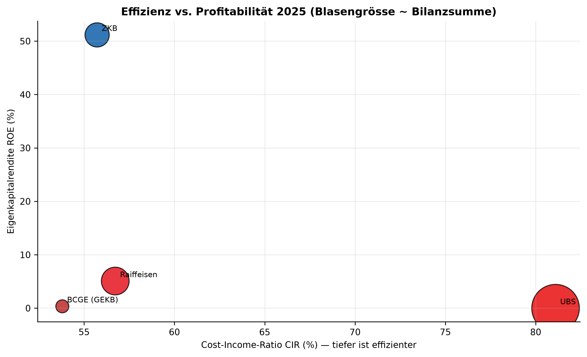
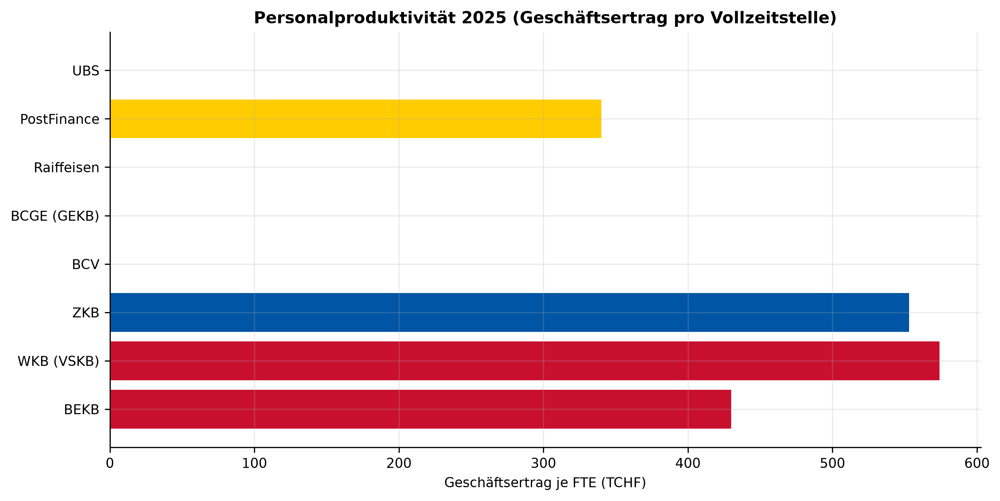

# 02 · Profitabilität, Effizienz & Produktivität (2025)

## 1. Management Summary
- Die Effizienzspanne (Cost-Income-Ratio) trennt schlanke Universal-/Kantonalbanken (**CIR ~45–55 %**) deutlich von integrations- oder gebührenintensiven Plattformmodellen (**PostFinance, UBS**).
- Bei der Produktivität je Vollzeitstelle (**Ertrag/FTE**) zeigen sich klare Skalenvorteile grosser Verbund- und Globalinstitute.

## 2. Effizienz- & Produktivitätsmatrix (2025)
| Institut | Ertrag 2025 (Mio.) | Reingewinn 2025 (Mio.) | CIR % | ROE % | FTE | Ertrag/FTE (TCHF) |
| --- | --- | --- | --- | --- | --- | --- |
| BEKB | 547,3 | 175,4 | 51,26 % | – % | 1'273 | 429,9 |
| WKB (VSKB) | 283,6 | 85,9 | 45,69 % | – % | 494 | 574,0 |
| ZKB | 3'213,0 | 1'241,0 | 55,71 % | 51,18 % | 5'809 | 553,1 |
| BCV | 1'149,9 | 430,0 | 48,66 % | – % | – | – |
| BCGE (GEKB) | 554,0 | 9,0 | 53,79 % | 0,36 % | – | – |
| Raiffeisen | 3'905,0 | 1'208,0 | 56,72 % | 5,08 % | – | – |
| PostFinance | 1'200,0 | 120,0 | 84,08 % | – % | 3'527 | 340,2 |
| UBS | 43,7 | 6,8 | 81,09 % | 0,01 % | – | – |

