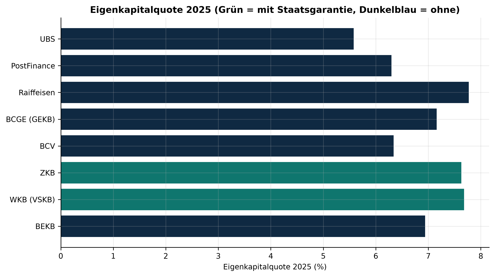

# 03 · Kapitalisierung, Regulierung & Staatsgarantie (Basel III final)

## 1. Management Summary
- Sämtliche 8 Institute übertreffen ihre jeweiligen **FINMA-Zielgrössen** (Kategorie 1 G-SIB, Kategorie 2 D-SIB bzw. Kategorie 3) komfortabel.
- Der Übergang zu **Basel III final (ab 01.01.2025)** reduziert bei risikoarmen Hypothekarbanken (Standardansatz) tendenziell die RWA-Dichte, während IRB-Banken (BCV) bzw. G-SIBs (UBS) schärfere Output-Floor-/TBTF-Vorgaben einhalten.

## 2. Aufsichtsrechtliche Kennzahlen (jüngster Stichtag)
| Institut | FINMA-Kat. | Staatsgarantie | Stichtag | CET1-Ist | CET1-Ziel | Puffer | Leverage % |
| --- | --- | --- | --- | --- | --- | --- | --- |
| BEKB | Kat. 3 | Keine | H1-2026 | 18,04 % | 9,26 % | 8,78 Pp. | – % |
| WKB (VSKB) | Kat. 3 | Ja | H1-2026 | 16,60 % | 9,20 % | 7,40 Pp. | – % |
| ZKB | Kat. 2 | Ja | H1-2026 | 20,10 % | 10,00 % | 10,10 Pp. | 7,10 % |
| BCV | Kat. 3 | Keine | H1-2026 | 17,60 % | 10,60 % | 7,00 Pp. | – % |
| BCGE (GEKB) | Kat. 3 | Keine | H1-2026 | 15,50 % | 9,20 % | 6,30 Pp. | 6,40 % |
| Raiffeisen | Kat. 2 | Keine | H1-2026 | 24,70 % | 10,00 % | 14,70 Pp. | 7,80 % |
| PostFinance | Kat. 2 | Keine | H1-2026 | 24,97 % | 10,00 % | 14,97 Pp. | 6,59 % |
| UBS | Kat. 1 | Keine | H1-2025 | 14,41 % | 14,00 % | 0,41 Pp. | 5,53 % |

