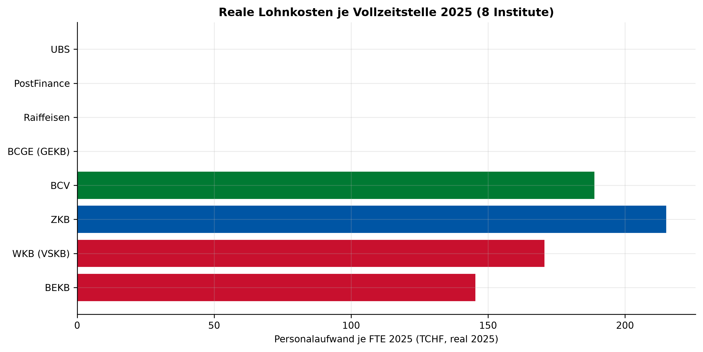
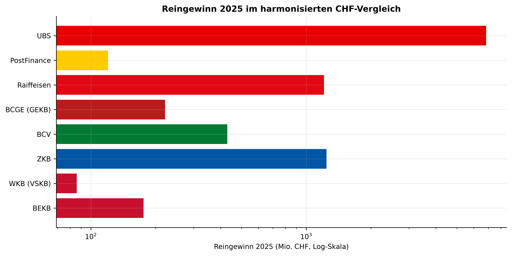

# 04 · Ausschüttung, Eigentümer & reale Vergütung (real 2025 CHF)

## 1. Management Summary
- Die 8 Institute decken vier unterschiedliche Eigentümermodelle ab (`listed_share`, `cantonal_endowment`, `cooperative_payout`, `post_dividend`).
- Alle Lohnkosten und Vergütungsreihen sind über `shared/cpi_bfs.py` (BFS LIK) auf **reale CHF 2025** normiert.

## 2. Eigentümer- & Lohnkostenvergleich (2025)
| Institut | Eigentümer-Modus | Gewinn 2025 (Mio.) | Lohn/FTE real (TCHF) | Kurs 2025 | Dividende 2025 |
| --- | --- | --- | --- | --- | --- |
| BEKB | listed_share | 175,4 | 145,4 | 309,50 | 10,80 |
| WKB (VSKB) | listed_share | 85,9 | 170,6 | 134,00 | 4,00 |
| ZKB | cantonal_endowment | 1'241,0 | 215,0 | – | – |
| BCV | listed_share | 430,0 | 188,8 | 100,40 | 4,40 |
| BCGE (GEKB) | listed_share | 221,0 | – | 24,60 | 0,70 |
| Raiffeisen | cooperative_payout | 1'208,0 | – | – | – |
| PostFinance | post_dividend | 120,0 | – | – | – |
| UBS | listed_share | 6'842,7 | – | 41,80 | 0,90 |

