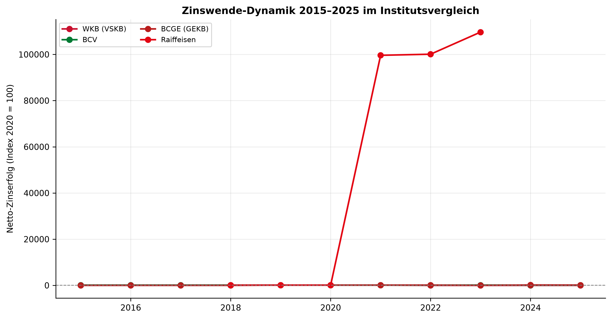

# 05 · Zinswenden, Saisonalität & Resilienz (2015–2026)

## 1. Management Summary
- Die **SNB-Zinswende 2022–2024** führte bei allen einlagenstarken Inlandbanken zu einem historischen Sprung des Netto-Zinserfolgs, am stärksten ausgeprägt bei **PostFinance** (Ende der Negativzins-Belastung auf SNB-Guthaben).
- Seit den Zinssenkungen 2024/2025 normalisieren sich die Zinsmargen wieder Richtung Langfristmittel.

## 2. Sonder- und Struktureffekte im Zeitverlauf
- **UBS 2023:** Einmaliger Negative Goodwill (~USD 27,7 Mrd.) aus der Credit-Suisse-Übernahme (`extraordinary_flag = CS_NEGATIVE_GOODWILL`).
- **BEKB 2015:** Einmalige Pensionskassen-Sanierungseinlage (83,8 Mio. CHF).
- **ZKB 2024:** Custody-Umklassierung im AuM-Ausweis (-55 Mrd. CHF) & Einführung der OECD-Mindeststeuer.
