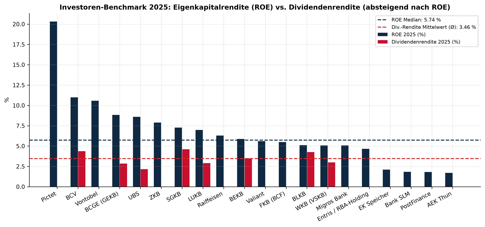
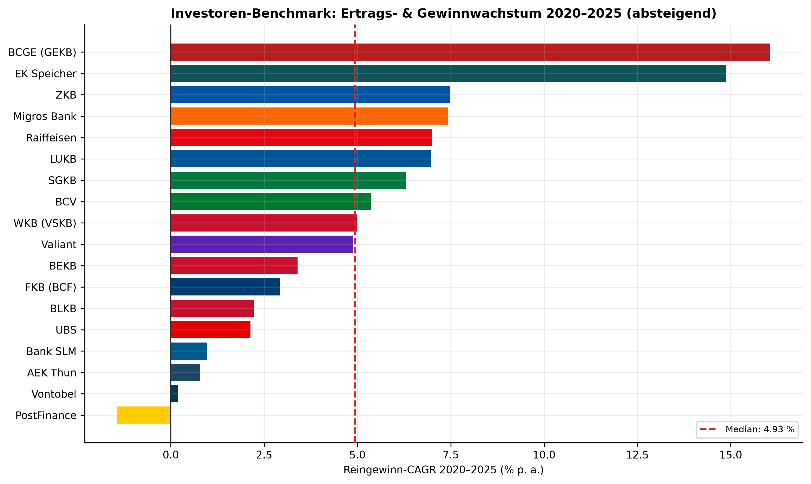

# 06 · Investoren-Branchenvergleich (20 Schweizer Banken, 2025)

## 1. Management Summary
- **Segment A (Kotierte & Zertifikats-Institute):** Die **BCV** erzielt 2025 mit **11,00 % ROE** die höchste Eigenkapitalrendite unter den Kantonalbanken bei attraktiver Dividendenrendite (**4,38 %**); **Vontobel (10,57 %)**, **GEKB (8,84 %)**, **UBS (8,60 %)**, **SGKB (7,28 %, Rendite 4,60 %)** und **LUKB (6,99 %)** folgen mit soliden Ausschüttungen.
- **Segment B (Öffentliche & Genossenschafts-Eigentümer):** **ZKB (1'241,0 Mio. CHF)** und **Raiffeisen (1'208,0 Mio. CHF)** erzielen die höchsten Inlandgewinne; **PostFinance** erzielt unter Kreditverbot `1,82 %` ROE bei höchster CET1-Quote (`24,97 %`).

## 2. Investoren- & Eigentümer-Kennzahlen (2025)
| Institut | Kotierung | Staatsgarantie | ROE 2025 | Kurs 2025 | Div./Aktie | Div.-Rendite | Gewinn-CAGR 20–25 | CET1 % |
| --- | --- | --- | --- | --- | --- | --- | --- | --- |
| BEKB | Kotiert (BEKN) | Keine | 5,88 % | 309,50 | 10,80 | 3,49 % | 3,40 % | 18,04 % |
| WKB (VSKB) | Kotiert (WKB) | Ja | 5,07 % | 134,00 | 4,00 | 2,99 % | 4,98 % | 16,60 % |
| ZKB | Nicht kotiert | Ja | 7,89 % | – | – | – % | 7,49 % | 20,10 % |
| BCV | Kotiert (BCVN) | Keine | 11,00 % | 100,40 | 4,40 | 4,38 % | 5,37 % | 17,60 % |
| BCGE (GEKB) | Kotiert (BCGE) | Keine | 8,84 % | 24,60 | 0,70 | 2,85 % | 16,06 % | 15,50 % |
| Raiffeisen | Nicht kotiert | Keine | 6,30 % | – | – | – % | 7,01 % | 24,70 % |
| PostFinance | Nicht kotiert | Keine | 1,82 % | – | – | – % | -1,44 % | 24,97 % |
| UBS | Kotiert (UBSG) | Keine | 8,60 % | 41,80 | 0,90 | 2,15 % | 2,14 % | 14,41 % |
| EK Speicher | Nicht kotiert | Keine | 2,11 % | – | – | – % | 14,87 % | – % |
| Bank SLM | Nicht kotiert | Keine | 1,83 % | – | – | – % | 0,96 % | – % |
| AEK Thun | Nicht kotiert | Keine | 1,70 % | – | – | – % | 0,79 % | – % |
| Migros Bank | Nicht kotiert | Keine | 5,07 % | – | – | – % | 7,44 % | – % |
| Vontobel | Kotiert (VONN) | Keine | 10,57 % | – | – | – % | 0,20 % | – % |
| Pictet | Nicht kotiert | Keine | 20,32 % | – | – | – % | – % | – % |
| Entris / RBA-Holding | Nicht kotiert | Keine | 4,66 % | – | – | – % | – % | – % |
| Valiant | Kotiert (VATN) | Keine | 5,60 % | – | – | – % | 4,89 % | 17,02 % |
| SGKB | Kotiert (SGKN) | Ja | 7,28 % | 435,00 | 20,00 | 4,60 % | 6,30 % | 15,40 % |
| LUKB | Kotiert (LUKN) | Ja | 6,99 % | 92,70 | 2,70 | 2,91 % | 6,98 % | 14,94 % |
| BLKB | Kotiert (BLKB) | Ja | 5,11 % | 984,00 | 42,00 | 4,27 % | 2,22 % | 20,99 % |
| FKB (BCF) | Nicht kotiert | Ja | 5,49 % | – | – | – % | 2,92 % | 18,17 % |

