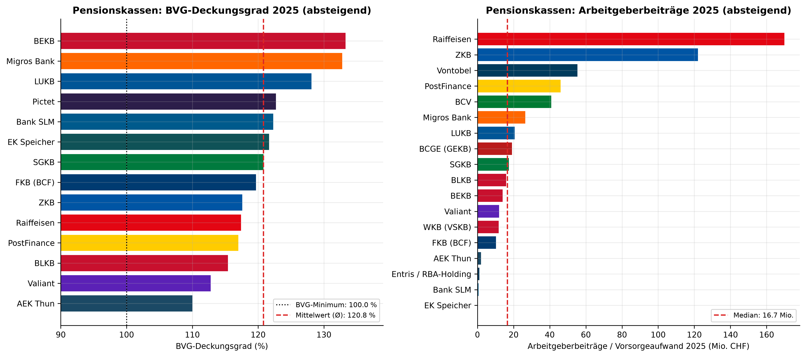

# 07 · Mitarbeiter- & Vorsorge-Branchenvergleich (20 Schweizer Banken, 2025)

## 1. Management Summary
- **Lohnkosten- / Produktivitätsverhältnis (2025):** Bei den **19 Instituten** liegt der durchschnittliche Geschäftsertrag je FTE bei **514,9 TCHF** (bei realen Lohnkosten je FTE von **Ø 177,6 TCHF**).
- **Vorsorgeeinrichtungen:** Alle Schweizer Banken mit Swiss-GAAP-FER-Ausweis weisen solide **BVG-Deckungsgrade** auf (Ø **120,9 %** über 13 berichtende Kassen, von **110,0 %** bis **133,3 %** bei BEKB).

## 2. Mitarbeiter-Benchmark (2025, real 2025 CHF)
| Institut | FTE 2025 | Ertrag/FTE (TCHF) | Personalaufw./FTE (TCHF) | Lohn / Produktivität | Ertrag / Lohn | CEO real (TCHF) | CEO Pay Ratio |
| --- | --- | --- | --- | --- | --- | --- | --- |
| BEKB | 1'058 | 517,3 | 145,4 | 28,1 % | 3,56× | 998,0 | 6,9× |
| WKB (VSKB) | 494 | 555,4 | 170,6 | 30,7 % | 3,26× | 790,0 | 4,6× |
| ZKB | 5'809 | 553,1 | 215,0 | 38,9 % | 2,57× | 2'826,2 | 13,1× |
| BCV | 2'083 | 552,0 | 188,8 | 34,2 % | 2,92× | 1'620,0 | 8,6× |
| BCGE (GEKB) | 958 | 578,0 | 190,7 | 33,0 % | 3,03× | 1'450,0 | 7,6× |
| Raiffeisen | 10'972 | 355,9 | 150,9 | 42,4 % | 2,36× | 1'780,0 | 11,8× |
| PostFinance | 3'527 | 340,2 | 149,4 | 43,9 % | 2,28× | 890,0 | 6,0× |
| UBS | 103'177 | 423,3 | 237,9 | 56,2 % | 1,78× | 14'900,0 | 62,6× |
| EK Speicher | 4 | 245,8 | 86,2 | 35,1 % | 2,85× | – | – |
| Bank SLM | 66 | 438,8 | 123,2 | 28,1 % | 3,56× | – | – |
| AEK Thun | 166 | 427,9 | 100,8 | 23,5 % | 4,25× | – | – |
| Migros Bank | 1'749 | 465,7 | 151,7 | 32,6 % | 3,07× | – | – |
| Vontobel | 2'310 | 619,5 | 305,6 | 49,3 % | 2,03× | – | – |
| Pictet | 5'507 | 582,3 | 293,2 | 50,3 % | 1,99× | – | – |
| Entris / RBA-Holding | 67 | 996,9 | 187,6 | 18,8 % | 5,31× | – | – |
| Valiant | 1'052 | 522,3 | 155,1 | 29,7 % | 3,37× | – | – |
| SGKB | 1'219 | 496,0 | 168,8 | 34,0 % | 2,94× | – | – |
| LUKB | 1'206 | 572,9 | 181,1 | 31,6 % | 3,16× | – | – |
| BLKB | 926 | 538,9 | 171,6 | 31,8 % | 3,14× | – | – |
| FKB (BCF) | 495 | 751,7 | 174,3 | 23,2 % | 4,31× | – | – |

## 3. Zugehörige Vorsorgeeinrichtungen (Pensionskassen)
| Institut | Vorsorgeeinrichtung | Standard | Aktive | Rentner | Deckungsgrad BVG | AG-Beiträge (Mio.) |
| --- | --- | --- | --- | --- | --- | --- |
| BEKB | Pensionskasse der Berner Kantonalbank AG | Swiss GAAP FER 16 / ARB | 1'593 | 791 | 133,3 % | 14,01 |
| WKB (VSKB) | Pensions- und Vorsorgekasse für das Personal der Walliser Kantonalbank | Swiss GAAP FER 16 / ARB | n. a. | n. a. | n. a. | 11,81 |
| ZKB | Pensionskasse der Zürcher Kantonalbank | Swiss GAAP FER 16 / ARB | 6'179 | 2'308 | 117,6 % | 122,00 |
| BCV | Caisse de pensions de la Banque Cantonale Vaudoise | Swiss GAAP FER 16 / ARB | 2'210 | 1'479 | n. a. | 40,90 |
| BCGE (GEKB) | Fondation de prévoyance professionnelle de la BCGE | Swiss GAAP FER 16 / ARB | n. a. | n. a. | n. a. | 19,13 |
| Raiffeisen | Raiffeisen Pensionskasse Genossenschaft (+ Arbeitgeberstiftung) | Swiss GAAP FER 16 / ARB | n. a. | n. a. | 117,4 % | 169,85 |
| PostFinance | Pensionskasse Post (Sammelstiftung Konzern Post) | Swiss GAAP FER 16 / FER 26 | 37'516 | 28'703 | 117,0 % | 46,00 |
| UBS | Pensionskasse der UBS (+ Credit Suisse Swiss Plan) | IFRS / IAS 19 (vs. BVV 2 lokal) | n. a. | n. a. | n. a. | n. a. |
| EK Speicher | ASGA Pensionskasse des Gewerbes (angeschlossen) | Swiss GAAP FER 16 / ARB | 4 | n. a. | 121,7 % | 0,02 |
| Bank SLM | Stiftung «Vorsorge FinTec» | Swiss GAAP FER 26 / ARB | n. a. | n. a. | 122,3 % | 0,64 |
| AEK Thun | Pensionskasse der AEK BANK 1826 | Swiss GAAP FER 16 / ARB | n. a. | n. a. | 110,0 % | 1,97 |
| Migros Bank | Migros-Pensionskasse (MPK) | Swiss GAAP FER 16 / ARB | n. a. | n. a. | 132,8 % | 26,50 |
| Vontobel | Vontobel Pensionskasse (IAS 19) | IFRS / IAS 19 | n. a. | n. a. | n. a. | 55,30 |
| Pictet | Fondation de prévoyance du Groupe Pictet | Swiss GAAP FER 26 / ARB | n. a. | n. a. | 122,7 % | n. a. |
| Entris / RBA-Holding | Pensionskasse Entris / Sammelstiftung (ARB) | Swiss GAAP FER 26 / ARB | 67 | n. a. | n. a. | 1,03 |
| Valiant | Pensionskasse Valiant (+ avenirplus.ch Ergänzungskasse) | Swiss GAAP FER 26 / ARB | 1'052 | n. a. | 112,8 % | 12,01 |
| SGKB | Personalvorsorgeeinrichtung der St. Galler Kantonalbank | Swiss GAAP FER 26 / ARB | n. a. | n. a. | 120,8 % | 17,38 |
| LUKB | Pensionskasse der Luzerner Kantonalbank | Swiss GAAP FER 26 / ARB | n. a. | n. a. | 128,1 % | 20,62 |
| BLKB | Pensionskasse der BLKB (Basellandschaftliche Pensionskasse BLPK) | Swiss GAAP FER 26 / ARB | n. a. | n. a. | 115,4 % | 15,93 |
| FKB (BCF) | Pensionskasse für das Personal der Freiburger Kantonalbank | Swiss GAAP FER 26 / ARB | 572 | 218 | 119,7 % | 10,32 |

