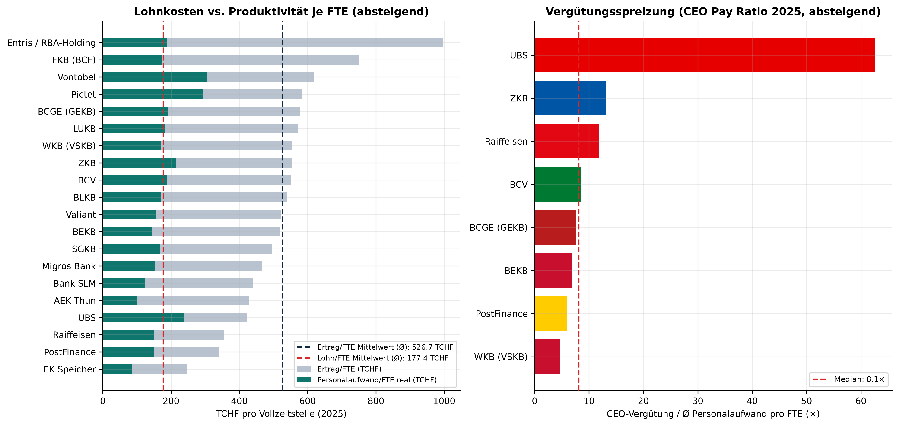

# 07 · Mitarbeiter- & Vorsorge-Branchenvergleich (20 Schweizer Banken, 2025)

## 1. Management Summary
- **Lohnkosten- / Produktivitätsverhältnis (2025):** Bei den **20 Instituten** liegt der durchschnittliche Geschäftsertrag je FTE bei **525,3 TCHF** (bei realen Lohnkosten je FTE von **Ø 177,8 TCHF**).
- **Personalfluktuation (Employee Turnover):** **15 von 20 Instituten** legen in ihren Geschäfts- bzw. separaten Nachhaltigkeitsberichten (GRI 401-1) quantitative Fluktuationsquoten offen (**161 Instituts-Jahreswerte** von 2003 bis 2025). Alle 15 berichtenden Institute verfügen über einen aktuellen Wert für **2025**: Die Bandbreite reicht von **4,3 % Netto / 7,8 % Brutto (LUKB)**, **4,6 % Netto (FKB)** und **5,0 % (ZKB)** über **6,9 % (BCV)**, **7,0 % (BEKB; aity AG: 2,0 %)**, **7,1 % Voluntary / 12,6 % Overall (UBS)**, **7,4 % Netto / 9,7 % Gesamt (Raiffeisen)**, **7,7 % (SGKB)**, **7,8 % Netto / 11,9 % Brutto (BLKB)**, **7,99 % (WKB/BCVS)**, **8,2 % (Pictet)**, **9,4 % (Valiant)** und **9,73 % (GEKB/BCGE)** bis **10,8 % (Vontobel)** und **11,1 % (Migros Bank)**.
- **Vorsorgeeinrichtungen:** Alle Schweizer Banken mit Swiss-GAAP-FER-Ausweis weisen solide **BVG-Deckungsgrade** auf (Ø **120,3 %** über 14 berichtende Kassen, von **110,0 %** bis **133,3 %** bei BEKB).

## 2. Mitarbeiter-Benchmark (2025, real 2025 CHF)
| Institut | FTE 2025 | Fluktuation (jüngst) | Ertrag/FTE (TCHF) | Personalaufw./FTE (TCHF) | Lohn / Produktivität | Ertrag / Lohn | CEO real (TCHF) | CEO Pay Ratio |
| --- | --- | --- | --- | --- | --- | --- | --- | --- |
| BEKB | 1'058 | 7,0 % | 517,3 | 145,4 | 28,1 % | 3,56× | 998,0 | 6,9× |
| WKB (VSKB) | 494 | 8,0 % | 555,4 | 170,6 | 30,7 % | 3,26× | 790,0 | 4,6× |
| ZKB | 5'809 | 5,0 % | 553,1 | 215,0 | 38,9 % | 2,57× | 2'826,2 | 13,1× |
| BCV | 2'083 | 6,9 % | 552,0 | 188,8 | 34,2 % | 2,92× | 1'620,0 | 8,6× |
| BCGE (GEKB) | 958 | 9,7 % | 578,0 | 190,7 | 33,0 % | 3,03× | 1'450,0 | 7,6× |
| Raiffeisen | 10'972 | 7,4 % | 355,9 | 150,9 | 42,4 % | 2,36× | 1'780,0 | 11,8× |
| PostFinance | 3'527 | n. a. | 340,2 | 149,4 | 43,9 % | 2,28× | 890,0 | 6,0× |
| UBS | 103'177 | 7,1 % | 423,3 | 237,9 | 56,2 % | 1,78× | 14'900,0 | 62,6× |
| EK Speicher | 4 | n. a. | 245,8 | 86,2 | 35,1 % | 2,85× | – | – |
| Bank SLM | 66 | n. a. | 438,8 | 123,2 | 28,1 % | 3,56× | – | – |
| AEK Thun | 166 | n. a. | 427,9 | 100,8 | 23,5 % | 4,25× | – | – |
| Migros Bank | 1'749 | 11,1 % | 465,7 | 151,7 | 32,6 % | 3,07× | – | – |
| Vontobel | 2'310 | 10,8 % | 619,5 | 305,6 | 49,3 % | 2,03× | – | – |
| Pictet | 5'507 | 8,2 % | 582,3 | 293,2 | 50,3 % | 1,99× | – | – |
| Entris / RBA-Holding | 67 | n. a. | 996,9 | 187,6 | 18,8 % | 5,31× | – | – |
| Valiant | 1'052 | 9,4 % | 522,3 | 155,1 | 29,7 % | 3,37× | – | – |
| SGKB | 1'219 | 7,7 % | 496,0 | 168,8 | 34,0 % | 2,94× | – | – |
| LUKB | 1'206 | 4,3 % | 572,9 | 181,1 | 31,6 % | 3,16× | – | – |
| BLKB | 926 | 7,8 % | 538,9 | 171,6 | 31,8 % | 3,14× | – | – |
| FKB (BCF) | 495 | 4,6 % | 751,7 | 174,3 | 23,2 % | 4,31× | – | – |

## 3. Bekannte Personalfluktuationen pro Jahr (offengelegte Zeitreihen, in %)
> **Methodik-Hinweis:** Vollständiger Datensatz in `comparison/data/xkb_personalfluktuation.csv` sowie in den jeweiligen Instituts-Panels (`turnover_rate_pct`, `turnover_net_pct`, `turnover_gross_pct`). Mehrere Institute haben den Ausweis der Personalfluktuation (GRI 401-1) in separate **Nachhaltigkeits- bzw. CSR/RSE-Berichte** ausgelagert: **BEKB** (NHB 2015–2025 für 2011–2025), **BLKB** (GNB/NHB 2010–2025; ab 2023 sowohl Netto- als auch Bruttofluktuation für den Gesamtkonzern), **FKB** (NHB 2023–2025 für 2019–2025; Fluktuationsrate netto, Zielwert `< 5 %`), **GEKB/BCGE** (*Rapport RSE* 2023–2025 für *BCGE Maison-mère* und *BCGE France*), **LUKB** (NHB 2024–2025 mit Netto- und Bruttofluktuation), **Migros Bank** (NHB 2024–2025; natürliche Austritte exkl. Pensionierungen/Tod), **Pictet** (*Group Sustainability Report* 2023–2025), **UBS** (*Sustainability Report Supplement* 2024–2025: *Voluntary turnover* in `rate`/`net`, *Overall turnover* inkl. Restrukturierung/CS-Integration in `gross`), **Valiant** (NHB 2023–2025) und **WKB/BCVS** (*Rapport RSE / CSR Report* 2023–2025; für 2021–2024 sind sowohl die Netto-Fluktuationsrate aus dem GB als auch die GRI-401-1-Gesamtrotationsrate inkl. Lernenden dokumentiert). Lediglich **5 von 20 Instituten** (PostFinance sowie die vier nicht GRI-berichtspflichtigen Regional-/Infrastrukturbanken AEK Thun, Bank SLM, EK Speicher, Entris) weisen keine institutsspezifische Fluktuationsquote aus (`n. a.`).

| Institut | 2016 | 2017 | 2018 | 2019 | 2020 | 2021 | 2022 | 2023 | 2024 | 2025 | Frühere Jahrgänge (2003–2015) | Definition / Methodik |
| --- | --- | --- | --- | --- | --- | --- | --- | --- | --- | --- | --- | --- |
| BEKB | 8,6 % | 6,3 % | 10,1 % | 8,0 % | 5,9 % | 7,0 % | 9,0 % | 9,0 % | 6,0 % | 7,0 % | 2011: 6,7 %, 2012: 5,4 %, 2013: 7,3 %, 2014: 8,8 %, 2015: 7,9 % | Fluktuationsrate netto (GRI G4-LA1 / GRI 401-1: fest angestellte Mitarbeitende ohne Lernende im Jahresdurchschnitt; ab NHB 2022 ganzzahlig gerundet) |
| WKB (VSKB) | 3,1 % | 2,3 % | 3,9 % | – | – | 6,5 % | 7,0 % | 6,6 % | 3,6 % | 8,0 % | 2003: 5,4 %, 2004: 4,4 %, 2005: 4,9 %, 2006: 3,8 %, 2007: 4,0 %, 2008: 3,3 %, 2009: 5,6 %, 2010: 2,9 %, 2014: 6,8 %, 2015: 5,5 % | Netto-Fluktuationsrate (exkl. Pensionierungen & Mutterschaft, 2016–2024) bzw. GRI 401-1 Taux de rotation du personnel (inkl. Brutto-Ausweis 2021–2025) |
| ZKB | 5,9 % | 5,7 % | 6,3 % | 5,8 % | 4,5 % | 5,9 % | 6,4 % | 6,1 % | 5,5 % | 5,0 % | 2010: 6,4 %, 2011: 6,5 %, 2012: 6,5 %, 2013: 7,7 %, 2014: 7,7 %, 2015: 6,8 % | Fluktuationsrate Stammhaus in % (Personalbericht / Kennzahlen Beschäftigung) |
| BCV | 8,4 % | 10,5 % | 9,8 % | 8,5 % | 8,8 % | 8,0 % | 9,5 % | 8,6 % | 7,7 % | 6,9 % | 2006: 11,8 %, 2007: 12,8 %, 2008: 11,3 %, 2009: 9,3 %, 2010: 9,8 %, 2011: 10,4 %, 2012: 9,4 %, 2013: 8,7 %, 2014: 9,2 %, 2015: 8,4 % | Taux moyen de rotation (Stammhaus; ab 2021 explizit exkl. Pensionierungen / hors départs en retraite) |
| BCGE (GEKB) | – | – | – | – | – | – | 9,3 % | 10,1 % | 8,3 % | 9,7 % | – | Taux de rotation du personnel BCGE Maison-mère (GRI 401-1: nombre de départs / effectif moyen) |
| Raiffeisen | 11,2 % | 12,5 % | 12,1 % | 14,3 % | 11,1 % | 10,4 % | 10,0 % | 8,5 % | 8,4 % | 7,4 % | 2012: 10,0 %, 2013: 11,8 %, 2014: 12,3 %, 2015: 10,7 % | Nettofluktuationsrate (freiwillige Austritte exkl. Gruppenübertritte, ab 2022) bzw. Brutto-/Gesamtfluktuationsrate (2012–2025) |
| UBS | – | – | – | – | – | – | 12,6 % | 12,4 % | 7,9 % | 7,1 % | – | Voluntary employee turnover rate in % (UBS Group; Gesamtfluktuation inkl. unfreiwilliger & neutraler Austritte in `gross`) |
| Migros Bank | – | – | – | – | – | – | – | – | 13,5 % | 11,1 % | – | Bruttofluktuationsrate in % (natürliche Austritte ohne ordentliche Pensionierungen, befristete Verträge, Tod & interne Wechsel / Ø Monatslohn-Bestand Schweiz) |
| Vontobel | – | – | 11,4 % | 14,2 % | 11,1 % | – | 9,8 % | 11,6 % | 11,4 % | 10,8 % | – | Employee turnover rate in % (GRI 401-1: permanent employees leaving / average permanent headcount) |
| Pictet | – | – | – | – | – | – | – | 7,1 % | 6,9 % | 8,2 % | – | Global employee turnover rate in % (GRI 401-1: total leavers / average active headcount over 12 months) |
| Valiant | 11,9 % | 11,7 % | 13,2 % | 12,5 % | 11,0 % | 10,5 % | 11,9 % | 12,0 % | 13,1 % | 9,4 % | 2014: 13,2 %, 2015: 14,1 % | Nettofluktuationsrate in % (alle durch Arbeitnehmende oder Arbeitgeber initiierten Austritte inkl. vorzeitiger Pensionierung auf eigenen Wunsch, GRI 401-1) |
| SGKB | 6,8 % | 6,9 % | 5,6 % | 5,1 % | 6,6 % | 4,6 % | 8,9 % | 7,3 % | 6,8 % | 7,7 % | – | Personalfluktuationsrate in % (freiwillige Fluktuation exkl. Pensionierungen und befristete Verträge, GRI 401-1) |
| LUKB | 3,6 % | 3,3 % | 4,1 % | 4,8 % | 4,1 % | 3,7 % | 5,5 % | 4,5 % | 3,2 % | 4,3 % | – | Netto-Fluktuationsrate Konzern (freiwillige Fluktuation exkl. Pensionierungen, befristete Verträge, Lernende & familiäre Gründe, GRI 401-1) |
| BLKB | 4,6 % | 5,0 % | 5,3 % | 6,3 % | 5,3 % | 5,6 % | 6,3 % | 7,4 % | 5,8 % | 7,8 % | 2006: 6,1 %, 2007: 7,8 %, 2008: 7,4 %, 2009: 4,8 %, 2010: 4,8 %, 2012: 3,6 %, 2013: 3,3 %, 2014: 4,1 %, 2015: 4,5 % | Natürliche / Netto-Fluktuationsrate (GRI G4-LA1 / GRI 401-1: exkl. Arbeitgeberkündigung, Pensionierungen, Schwangerschaften & Todesfälle; 2013–2025) bzw. einfache Fluktuationsrate (GRI G3 LA2, 2006–2012) |
| FKB (BCF) | – | – | – | 3,8 % | 1,9 % | 2,3 % | 4,0 % | 2,6 % | 3,1 % | 4,6 % | – | Fluktuationsrate netto insgesamt in % (GRI 401-1: Rotationsrate des Personals, Zielwert < 5 %) |

## 4. Zugehörige Vorsorgeeinrichtungen (Pensionskassen)
| Institut | Vorsorgeeinrichtung | Standard | Aktive | Rentner | Deckungsgrad BVG | AG-Beiträge (Mio.) |
| --- | --- | --- | --- | --- | --- | --- |
| BEKB | Pensionskasse der Berner Kantonalbank AG | Swiss GAAP FER 16 / ARB | 1'593 | 791 | 133,3 % | 14,01 |
| WKB (VSKB) | Pensions- und Vorsorgekasse für das Personal der Walliser Kantonalbank | Swiss GAAP FER 16 / ARB | n. a. | n. a. | n. a. | 11,81 |
| ZKB | Pensionskasse der Zürcher Kantonalbank | Swiss GAAP FER 16 / ARB | 6'179 | 2'308 | 117,6 % | 122,00 |
| BCV | Caisse de pensions de la Banque Cantonale Vaudoise | Swiss GAAP FER 16 / ARB | 2'210 | 1'479 | n. a. | 40,90 |
| BCGE (GEKB) | Fondation de prévoyance professionnelle de la BCGE | Swiss GAAP FER 16 / ARB | n. a. | n. a. | n. a. | 19,13 |
| Raiffeisen | Raiffeisen Pensionskasse Genossenschaft (+ Arbeitgeberstiftung) | Swiss GAAP FER 16 / ARB | n. a. | n. a. | 117,4 % | 169,85 |
| PostFinance | Pensionskasse Post (Sammelstiftung Konzern Post) | Swiss GAAP FER 16 / FER 26 | 37'516 | 28'703 | 117,0 % | 46,00 |
| UBS | Pensionskasse der UBS (+ Credit Suisse Swiss Plan) | IFRS / IAS 19 (vs. BVV 2 lokal) | n. a. | n. a. | n. a. | n. a. |
| EK Speicher | ASGA Pensionskasse des Gewerbes (angeschlossen) | Swiss GAAP FER 16 / ARB | 4 | n. a. | 121,7 % | 0,02 |
| Bank SLM | Stiftung «Vorsorge FinTec» | Swiss GAAP FER 26 / ARB | n. a. | n. a. | 122,3 % | 0,64 |
| AEK Thun | Pensionskasse der AEK BANK 1826 | Swiss GAAP FER 16 / ARB | n. a. | n. a. | 110,0 % | 1,97 |
| Migros Bank | Migros-Pensionskasse (MPK) | Swiss GAAP FER 16 / ARB | n. a. | n. a. | 132,8 % | 26,50 |
| Vontobel | Vontobel Pensionskasse (IAS 19) | IFRS / IAS 19 | n. a. | n. a. | n. a. | 55,30 |
| Pictet | Fondation de prévoyance du Groupe Pictet | Swiss GAAP FER 26 / ARB | n. a. | n. a. | 122,7 % | n. a. |
| Entris / RBA-Holding | Pensionskasse Entris / Sammelstiftung (ARB) | Swiss GAAP FER 26 / ARB | 67 | n. a. | n. a. | 1,03 |
| Valiant | Pensionskasse Valiant (+ avenirplus.ch Ergänzungskasse) | Swiss GAAP FER 26 / ARB | 1'052 | n. a. | 112,8 % | 12,01 |
| SGKB | Personalvorsorgeeinrichtung der St. Galler Kantonalbank | Swiss GAAP FER 26 / ARB | n. a. | n. a. | 120,8 % | 17,38 |
| LUKB | Pensionskasse der Luzerner Kantonalbank | Swiss GAAP FER 26 / ARB | n. a. | n. a. | 128,1 % | 20,62 |
| BLKB | Pensionskasse der BLKB (Basellandschaftliche Pensionskasse BLPK) | Swiss GAAP FER 26 / ARB | n. a. | n. a. | 115,4 % | 15,93 |
| FKB (BCF) | Pensionskasse für das Personal der Freiburger Kantonalbank | Swiss GAAP FER 26 / ARB | 572 | 218 | 119,7 % | 10,32 |

