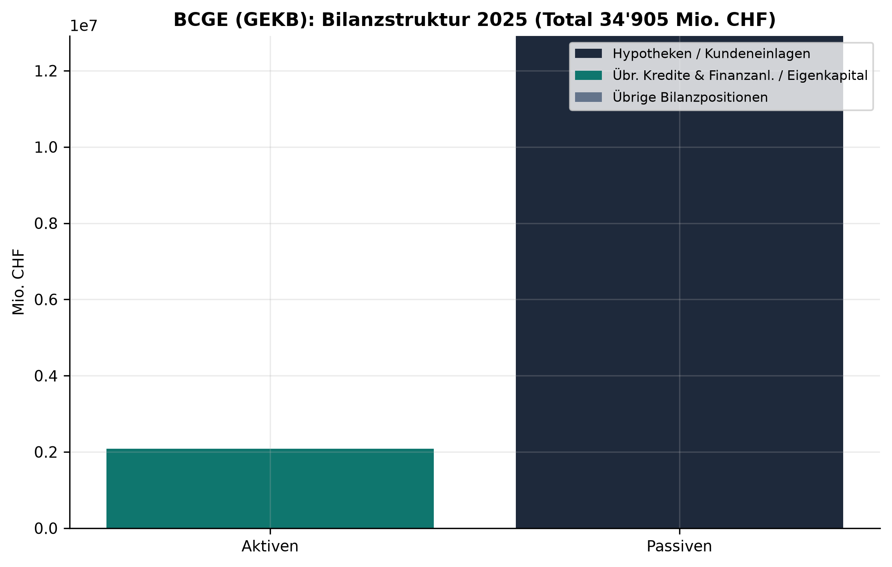
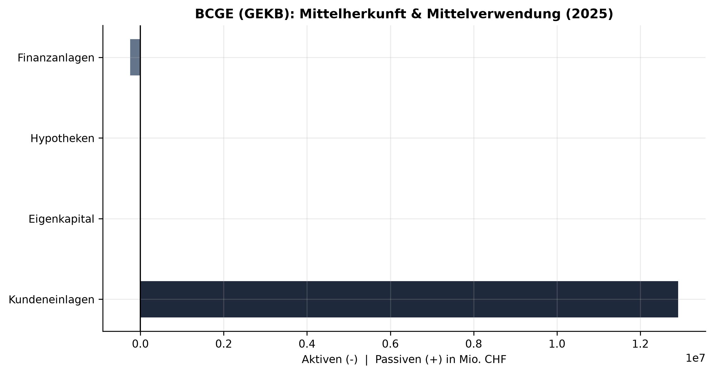
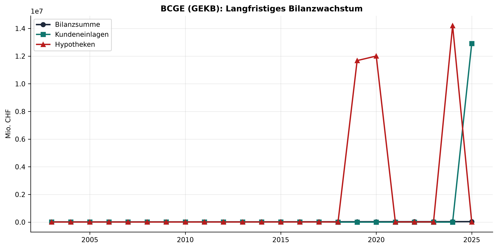

# 02 · Bilanzwachstum, Hypotheken & Refinanzierung (2003–2025): Banque Cantonale de Genève

## 1. Management Summary
- Die Bilanzsumme wuchs von **14'561,3 Mio. CHF** (2003) auf **34'905,0 Mio. CHF** (2025, CAGR **4,05 %**).
- Die Hypothekarforderungen machen im Jahr 2025 **32,4 %** der Bilanzsumme aus.
- Die Kundeneinlagen belaufen sich 2025 auf **12'908'052,0 Mio. CHF**, das Eigenkapital auf **2'499,0 Mio. CHF** (Eigenkapitalquote **7,16 %**).

## 2. Quantitative Entwicklung
| Jahr | Bilanzsumme | Hypotheken | Finanzanlagen | Kundeneinlagen | Eigenkapital | Deckungsgrad |
| --- | --- | --- | --- | --- | --- | --- |
| 2003 | 14'561,3 | 6'020,0 | 92,4 | 5'021,8 | 615,1 | 41,8 % |
| 2004 | 13'891,7 | 5'984,1 | 240,2 | 4'846,3 | 626,1 | 42,6 % |
| 2005 | 12'783,1 | 6'191,0 | 278,4 | 4'862,2 | 654,2 | 44,2 % |
| 2006 | 12'571,0 | 6'189,3 | 380,5 | 4'609,9 | 705,2 | 44,5 % |
| 2007 | 12'498,5 | 6'393,4 | 409,4 | 4'438,3 | 0,9 | 43,1 % |
| 2008 | 13'690,3 | 6'792,0 | 621,4 | 4'997,4 | 912,5 | 49,9 % |
| 2009 | 14'114,5 | 7'603,8 | 1'204,3 | 5'511,9 | 957,1 | 49,0 % |
| 2010 | 14'257,2 | 7'999,7 | 1'206,7 | 5'430,1 | 965,9 | 47,1 % |
| 2011 | 15'871,0 | 8'765,1 | 1'207,9 | 5'438,4 | 965,9 | 42,3 % |
| 2012 | 16'472,7 | 9'071,0 | 1'253,9 | 4'910,7 | 1'085,8 | 37,8 % |
| 2013 | 16'619,0 | 9'319,1 | 1'277,0 | 5'100,1 | 1'163,0 | 38,8 % |
| 2014 | 17'493,8 | 9'503,6 | 1'722,7 | 4'920,3 | 1'235,5 | 36,3 % |
| 2015 | 20'016,2 | 9'966,1 | 1'856,2 | 12'732,3 | 1'319,2 | 92,9 % |
| 2016 | 21'392,7 | 10'366,5 | 1'831,7 | 13'233,4 | 1'386,0 | 88,4 % |
| 2017 | 22'671,3 | 10'985,4 | 1'750,0 | 14'548,8 | 1'472,2 | 92,7 % |
| 2018 | 23'033,8 | 11'387,7 | 1'883,4 | 0,0 | 1'569,9 | 0,0 % |
| 2019 | 24'919,0 | 11'678'303,0 | 1'956'852,0 | 5,0 | 1'666'736,0 | 0,0 % |
| 2020 | 27'542,0 | 12'005'607,0 | 2'210'757,0 | 5,0 | 1'716'341,0 | 0,0 % |
| 2021 | 28'293,7 | 12'665,9 | 2'124,8 | 0,0 | 1'827,2 | 0,0 % |
| 2022 | 30'034,4 | 13'045,7 | 2'339,2 | 0,0 | 1'983,7 | 0,0 % |
| 2023 | 30'269,6 | 13'582,3 | 2'648,6 | 0,0 | 2'183,5 | 0,0 % |
| 2024 | 32'436,0 | 14'204'922,0 | 2'896'031,0 | 4,0 | 2'346,0 | 0,0 % |
| 2025 | 34'905,0 | 11'308,0 | 242'520,0 | 12'908'052,0 | 2'499,0 | 699,2 % |

## 3. Treiberanalyse & Wendepunkte
- **2008:** Abwicklung Fondation de valorisation
- **2015:** Umstellung auf FINMA-RVB
- **2025:** Inkrafttreten Basel III final per 01.01.2025

## 4. Fazit & Ausblick
- Refinanzierungsbasis und Bilanzstruktur bleiben eng an Kundeneinlagen und die jeweilige Geschäftsmodell-Spezialisierung gekoppelt.
