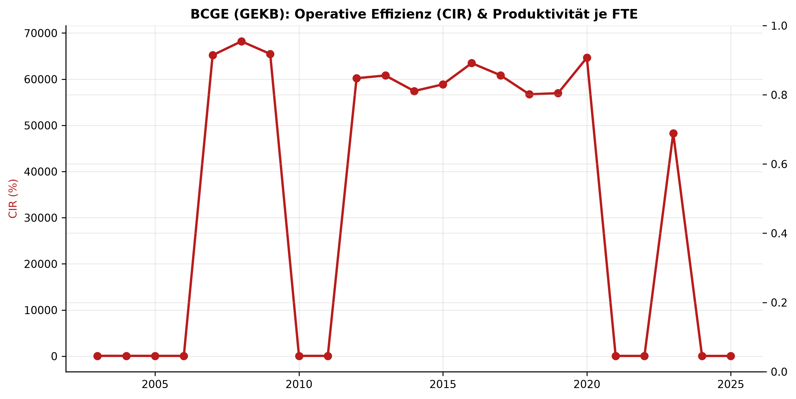

# 04 · Operative Effizienz & Transformation (2003–2025): Banque Cantonale de Genève

## 1. Management Summary
- Die Cost-Income-Ratio (CIR) liegt im Jahr 2025 bei **53,79 %** (vs. 72,46 % im Jahr 2003), die Eigenkapitalrendite (ROE) bei **0,36 %**.
- Der Personalbestand umfasst 2025 **– FTE** bei einem Ertrag pro Vollzeitstelle von **– TCHF**.

## 2. Quantitative Entwicklung
| Jahr | CIR % | ROE % | FTE | Ertrag/FTE (TCHF) | Bilanz/FTE (Mio.) | Filialen |
| --- | --- | --- | --- | --- | --- | --- |
| 2003 | 72,46 % | 0,00 % | – | – | – | – |
| 2004 | 71,58 % | 0,00 % | – | – | – | – |
| 2005 | 66,10 % | 0,00 % | – | – | – | – |
| 2006 | 63,47 % | 8,66 % | – | – | – | – |
| 2007 | 65'196,27 % | 8'682,43 % | – | – | – | – |
| 2008 | 68'205,96 % | 7,47 % | – | – | – | – |
| 2009 | 65'478,68 % | 7,48 % | – | – | – | – |
| 2010 | 64,35 % | 5,84 % | – | – | – | – |
| 2011 | 64,99 % | 6,53 % | – | – | – | – |
| 2012 | 60'217,34 % | 6,17 % | – | – | – | – |
| 2013 | 60'804,78 % | 6,27 % | – | – | – | – |
| 2014 | 57'435,83 % | 6,16 % | – | – | – | – |
| 2015 | 58'884,68 % | 5,93 % | – | – | – | – |
| 2016 | 63'482,81 % | 5,70 % | – | – | – | – |
| 2017 | 60'856,56 % | 5,54 % | – | – | – | – |
| 2018 | 56'729,83 % | 5,81 % | – | – | – | – |
| 2019 | 56'975,00 % | 5,81 % | – | – | – | – |
| 2020 | 64'658,31 % | 6,12 % | – | – | – | – |
| 2021 | 57,83 % | 6,85 % | – | – | – | – |
| 2022 | 54,93 % | 8,87 % | – | – | – | – |
| 2023 | 48'296,61 % | 10,59 % | – | – | – | – |
| 2024 | 51,62 % | 0,43 % | – | – | – | – |
| 2025 | 53,79 % | 0,36 % | – | – | – | – |

## 3. Treiberanalyse & Wendepunkte
- **2008:** Abwicklung Fondation de valorisation
- **2015:** Umstellung auf FINMA-RVB
- **2025:** Inkrafttreten Basel III final per 01.01.2025

## 4. Fazit & Ausblick
- Digitalisierung und Skalierung steigern Bilanzsumme und Geschäftsvolumen pro Vollzeitstelle langfristig.
