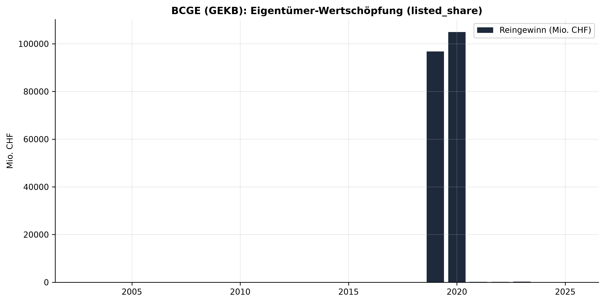

# 05 · Aktie, Dividenden & Wertschöpfung (2003–2025): Banque Cantonale de Genève

> **Eigentümer-Modus:** `listed_share` | **Staatsgarantie:** Keine | **Ticker:** `BCGE`

## 1. Management Summary
- Im Geschäftsjahr 2025 erwirtschaftete BCGE (GEKB) einen Gewinn von **9,0 Mio. CHF** bei einem Eigenkapital von **2'499,0 Mio. CHF**.
- Die Ausschüttungs- und Kapitalstruktur folgt dem spezifischen Governance-Modell (`listed_share`).

## 2. Quantitative Entwicklung
| Jahr | Reingewinn (Mio.) | Eigenkapital (Mio.) | Aktienkurs (split-ber.) | Dividende/Aktie | Div.-Rendite | Öff. Ablieferung (Mio.) |
| --- | --- | --- | --- | --- | --- | --- |
| 2003 | 0,0 | 615,1 | – | – | – % | – |
| 2004 | 0,0 | 626,1 | – | – | – % | – |
| 2005 | 0,0 | 654,2 | – | – | – % | – |
| 2006 | 61,1 | 705,2 | – | – | – % | – |
| 2007 | 77,1 | 0,9 | – | – | – % | – |
| 2008 | 68,1 | 912,5 | – | – | – % | – |
| 2009 | 71,6 | 957,1 | – | – | – % | – |
| 2010 | 56,4 | 965,9 | – | – | – % | – |
| 2011 | 63,1 | 965,9 | – | – | – % | – |
| 2012 | 67,0 | 1'085,8 | – | – | – % | – |
| 2013 | 73,0 | 1'163,0 | – | – | – % | – |
| 2014 | 76,2 | 1'235,5 | – | – | – % | – |
| 2015 | 78,2 | 1'319,2 | – | – | – % | – |
| 2016 | 79,0 | 1'386,0 | – | – | – % | – |
| 2017 | 81,6 | 1'472,2 | – | – | – % | – |
| 2018 | 91,2 | 1'569,9 | – | – | – % | – |
| 2019 | 96'814,0 | 1'666'736,0 | – | – | – % | – |
| 2020 | 104'962,0 | 1'716'341,0 | – | – | – % | – |
| 2021 | 125,2 | 1'827,2 | – | – | – % | – |
| 2022 | 175,9 | 1'983,7 | – | – | – % | – |
| 2023 | 231,2 | 2'183,5 | – | – | – % | – |
| 2024 | 10,0 | 2'346,0 | – | – | – % | – |
| 2025 | 9,0 | 2'499,0 | – | – | – % | – |

## 3. Treiberanalyse & Wendepunkte
- Bei kotierten Instituten mit Aktiensplits (z. B. BCV 1:10 im Jahr 2020) sind sämtliche historischen Kurs- und Dividendenreihen deterministisch split-bereinigt.

## 4. Fazit & Ausblick
- Stabile Ertragskraft sichert langfristig Dividendenkontinuität bzw. verlässliche Ablieferungen an Kanton, Post oder Genossenschafter.
