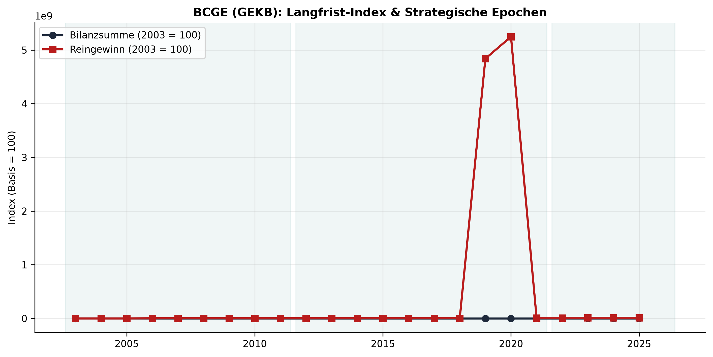
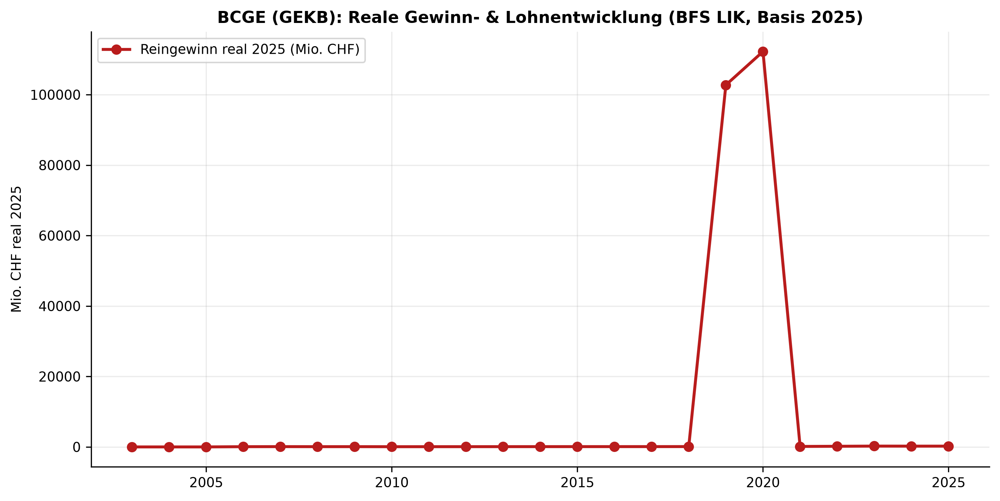

# 07 · Strategische Epochen, Governance, reale Vergütung & Vorsorge (2003–2025): Banque Cantonale de Genève

> **Preisbasis:** Sämtliche Realgrössen sind mit dem offiziellen **BFS Landesindex der Konsumentenpreise (LIK, Dez. 1982 = 100)** deterministisch auf **reale CHF 2025** deflationiert.

## 1. Management Summary & Strategische Epochen
- **Epoche 1 (2003–2011):** Nachgang Sanierung & Fondation de valorisation
- **Epoche 2 (2012–2021):** Internationalisierung & Eigenkapitalaufbau
- **Epoche 3 (2022–2026):** Zinswende, Commodity Finance & Basel III final

## 2. Reale Gewinn-, Lohn- & Vergütungsentwicklung (real 2025 CHF)
| Jahr | Gewinn nom. | Gewinn real 2025 | Lohn/FTE real (TCHF) | VR real (TCHF) | CEO real (TCHF) | GL real (TCHF) |
| --- | --- | --- | --- | --- | --- | --- |
| 2003 | 0,0 | 0,0 | – | – | – | – |
| 2004 | 0,0 | 0,0 | – | – | – | – |
| 2005 | 0,0 | 0,0 | – | – | – | – |
| 2006 | 61,1 | 66,7 | – | – | – | – |
| 2007 | 77,1 | 83,6 | – | – | – | – |
| 2008 | 68,1 | 72,1 | – | – | – | – |
| 2009 | 71,6 | 76,2 | – | – | – | – |
| 2010 | 56,4 | 59,6 | – | – | – | – |
| 2011 | 63,1 | 66,5 | – | – | – | – |
| 2012 | 67,0 | 71,1 | – | – | – | – |
| 2013 | 73,0 | 77,6 | – | – | – | – |
| 2014 | 76,2 | 81,0 | – | – | – | – |
| 2015 | 78,2 | 84,2 | – | – | – | – |
| 2016 | 79,0 | 85,4 | – | – | – | – |
| 2017 | 81,6 | 87,8 | – | – | – | – |
| 2018 | 91,2 | 97,1 | – | – | – | – |
| 2019 | 96'814,0 | 102'747,6 | – | – | – | – |
| 2020 | 104'962,0 | 112'237,2 | – | – | – | – |
| 2021 | 125,2 | 133,1 | – | – | – | – |
| 2022 | 175,9 | 181,8 | – | – | – | – |
| 2023 | 231,2 | 234,0 | – | – | – | – |
| 2024 | 219,0 | 219,3 | – | – | – | – |
| 2025 | 221,0 | 221,0 | – | 1'280,0 | 1'450,0 | 5'477,1 |

## 3. Arbeitgeber-Attraktivität & Vorsorgeeinrichtung (Pensionskasse)
- **Vorsorgeeinrichtung:** Fondation de prévoyance professionnelle de la BCGE (*Beitragsprimat (umhüllend)*, Basis: `Swiss GAAP FER 16 / ARB`)
- **Versichertenstruktur:** Aktive **–**, Rentner **–** (Verhältnis Aktive/Rentner: **–**)
- **Deckungsgrad (BVG) / Reserven:** Deckungsgrad **– %**, Arbeitgeberbeitragsreserve **– Mio. CHF**, Sondereinlagen **0,0 Mio. CHF**
- **CEO-zu-Mitarbeitenden-Pay-Ratio (2025):** **–×** (CEO real 2025: 1'450,0 TCHF vs. Ø Personalaufwand/FTE: – TCHF)
- **Quelle:** `gekb/.md/gekb-geschaeftsbericht-2024.md; gekb/.md/gekb-geschaeftsbericht-2025.md` — Haupt-Vorsorgeeinrichtung der BCGE-Gruppe, deckt alle Mitarbeitenden des Stammhauses ab.

## 4. Treiberanalyse, Strukturbrüche & Ausblick
- **2008:** Abwicklung Fondation de valorisation
- **2015:** Umstellung auf FINMA-RVB
- **2025:** Inkrafttreten Basel III final per 01.01.2025
- Die gemeinsame Inflationsbereinigung auf `real 2025 CHF` ermöglicht den unverzerrten Vergleich von Produktivität, Reallöhnen, Pay Ratio und Pensionskassen-Resilienz im Branchenvergleich (`comparison/reports/07_mitarbeiter_und_vorsorge_branchenvergleich.md`).
