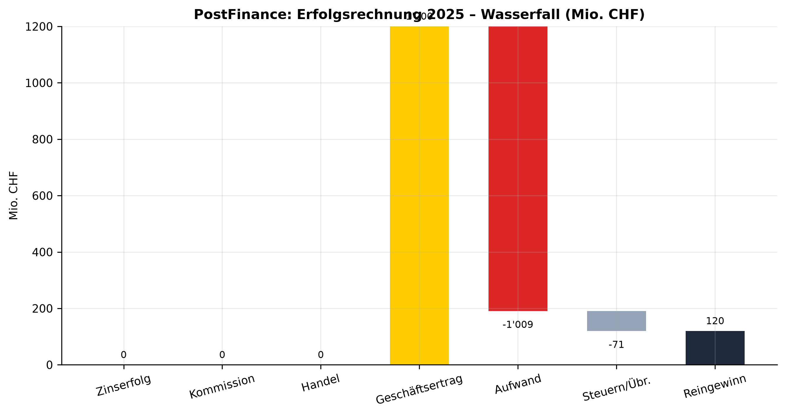
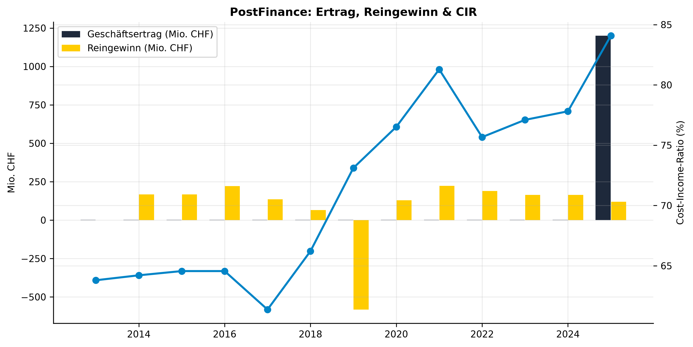

# 01 · Zinszyklen & Ertragsarchitektur (2013–2025): PostFinance AG

> **Scope:** `standalone` | **Standard:** `ARB_RVB` | **Währung:** Mio. CHF (harmonisierte Zeitreihe)

## 1. Management Summary
- Im Zeitraum **2013–2025** entwickelte sich der Geschäftsertrag von **1,5 Mio. CHF** auf **1'200,0 Mio. CHF** (CAGR **74,80 % p. a.**).
- Der Reingewinn erreichte im jüngsten Geschäftsjahr 2025 **120,0 Mio. CHF** (nach 0,0 Mio. CHF im Jahr 2013).
- Der Netto-Zinserfolg trägt aktuell **– %** zum Gesamtertrag bei, das Kommissionsgeschäft **– %** und das Handelsgeschäft **– %**.

## 2. Quantitative Entwicklung
| Jahr | Zinserfolg (Mio.) | Kommission (Mio.) | Handel (Mio.) | Geschäftsertrag | Geschäftserfolg | Reingewinn | Zinsanteil |
| --- | --- | --- | --- | --- | --- | --- | --- |
| 2013 | 0,9 | 0,2 | 0,0 | 1,5 | 0,5 | 0,0 | 63,3 % |
| 2014 | 1,0 | 0,2 | 0,0 | 1,5 | 0,5 | 167,0 | 64,1 % |
| 2015 | – | – | 0,0 | 1,5 | 0,3 | 167,0 | – % |
| 2016 | – | – | 0,0 | 1,5 | 0,3 | 221,0 | – % |
| 2017 | – | – | 0,0 | 1,6 | 0,3 | 136,0 | – % |
| 2018 | – | – | 0,0 | 1,6 | 0,2 | 66,0 | – % |
| 2019 | – | – | 0,0 | 1,4 | 0,1 | -582,0 | – % |
| 2020 | – | – | 0,0 | 1,3 | -0,6 | 129,0 | – % |
| 2021 | – | – | 0,0 | 1,2 | 0,1 | 223,0 | – % |
| 2022 | – | – | 0,0 | 1,3 | 0,2 | 190,0 | – % |
| 2023 | – | – | 0,0 | 1,2 | 0,2 | 164,0 | – % |
| 2024 | – | – | 0,0 | 1,2 | 0,2 | 164,0 | – % |
| 2025 | – | – | – | 1'200,0 | – | 120,0 | – % |

## 3. Treiberanalyse & Wendepunkte
- **2013:** Ausgründung als AG unter FINMA-Aufsicht (mit Kreditverbot)
- **2023:** Zinswende-Effekt auf SNB-Guthaben & Finanzanlagen
- **2025:** Inkrafttreten Basel III final per 01.01.2025

## 4. Fazit & Ausblick
- Die Ertragsarchitektur von PostFinance spiegelt die Zinszyklen (Negativzinsphase 2015–2022, Zinswende 2022–2024, Zinssenkungen ab 2025) unmittelbar wider.
