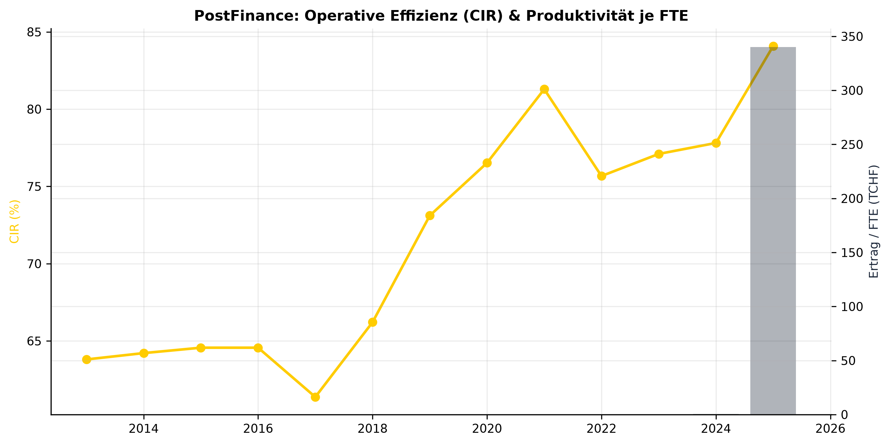

# 04 · Operative Effizienz & Transformation (2013–2025): PostFinance AG

## 1. Management Summary
- Die Cost-Income-Ratio (CIR) liegt im Jahr 2025 bei **84,08 %** (vs. 63,80 % im Jahr 2013), die Eigenkapitalrendite (ROE) bei **1,82 %**.
- Der Personalbestand umfasst 2025 **3'527,0 FTE** bei einem Ertrag pro Vollzeitstelle von **340,2 TCHF**.

## 2. Quantitative Entwicklung
| Jahr | CIR % | ROE % | FTE | Ertrag/FTE (TCHF) | Bilanz/FTE (Mio.) | Filialen |
| --- | --- | --- | --- | --- | --- | --- |
| 2013 | 63,80 % | – % | – | – | – | – |
| 2014 | 64,21 % | – % | – | – | – | – |
| 2015 | 64,56 % | – % | – | – | – | – |
| 2016 | 64,56 % | – % | – | – | – | – |
| 2017 | 61,37 % | – % | – | – | – | – |
| 2018 | 66,21 % | – % | – | – | – | – |
| 2019 | 73,11 % | – % | – | – | – | – |
| 2020 | 76,52 % | – % | – | – | – | – |
| 2021 | 81,29 % | – % | – | – | – | – |
| 2022 | 75,67 % | – % | – | – | – | – |
| 2023 | 77,10 % | – % | – | – | – | – |
| 2024 | 77,81 % | – % | 3'464,0 | 0,4 | 29,52 | – |
| 2025 | 84,08 % | 1,82 % | 3'527,0 | 340,2 | 29,72 | – |

## 3. Treiberanalyse & Wendepunkte
- **2013:** Ausgründung als AG unter FINMA-Aufsicht (mit Kreditverbot)
- **2023:** Zinswende-Effekt auf SNB-Guthaben & Finanzanlagen
- **2025:** Inkrafttreten Basel III final per 01.01.2025

## 4. Fazit & Ausblick
- Digitalisierung und Skalierung steigern Bilanzsumme und Geschäftsvolumen pro Vollzeitstelle langfristig.
