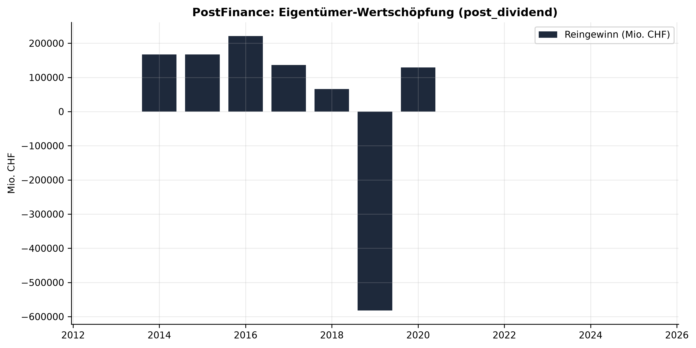

# 05 · Dividendenablieferung an Post AG & Eigentümerwert (2013–2025): PostFinance AG

> **Eigentümer-Modus:** `post_dividend` | **Staatsgarantie:** Keine | **Ticker:** `nicht kotiert`

## 1. Management Summary
- Im Geschäftsjahr 2025 erwirtschaftete PostFinance einen Gewinn von **120,0 Mio. CHF** bei einem Eigenkapital von **6'608,0 Mio. CHF**.
- **Eigenkapitalrendite (2025):** ROE **1,82 %** bei einem Eigenkapital von **6'608,0 Mio. CHF**.

## 2. Quantitative Entwicklung
| Jahr | Reingewinn (Mio.) | Eigenkapital (Mio.) | Aktienkurs (split-ber.) | Dividende/Aktie | Div.-Rendite | Öff. Ablieferung (Mio.) |
| --- | --- | --- | --- | --- | --- | --- |
| 2013 | 0,0 | – | – | – | – % | – |
| 2014 | 167,0 | – | – | – | – % | – |
| 2015 | 167,0 | – | – | – | – % | – |
| 2016 | 221,0 | – | – | – | – % | – |
| 2017 | 136,0 | – | – | – | – % | – |
| 2018 | 66,0 | – | – | – | – % | – |
| 2019 | -582,0 | – | – | – | – % | – |
| 2020 | 129,0 | – | – | – | – % | – |
| 2021 | 0,2 | – | – | – | – % | – |
| 2022 | 0,2 | – | – | – | – % | – |
| 2023 | 0,2 | – | – | – | – % | – |
| 2024 | 0,2 | – | – | – | – % | – |
| 2025 | 120,0 | 6'608,0 | – | – | – % | 70,0 |

## 3. Treiberanalyse & Wendepunkte (Investoren-Perspektive)
- Bei kotierten Instituten mit Aktiensplits (z. B. BCV 1:10 im Jahr 2020) sind sämtliche historischen Kurs- und Dividendenreihen deterministisch split-bereinigt.
- Im Branchenvergleich (siehe `comparison/reports/06_investoren_branchenvergleich.md`) werden P/B, P/E, Dividendenrendite und Eigentümer-Ablieferungen über alle 8 Institute eingeordnet.

## 4. Fazit & Ausblick
- Stabile Ertragskraft sichert langfristig Dividendenkontinuität bzw. verlässliche Ablieferungen an Kanton, Post oder Genossenschafter.
