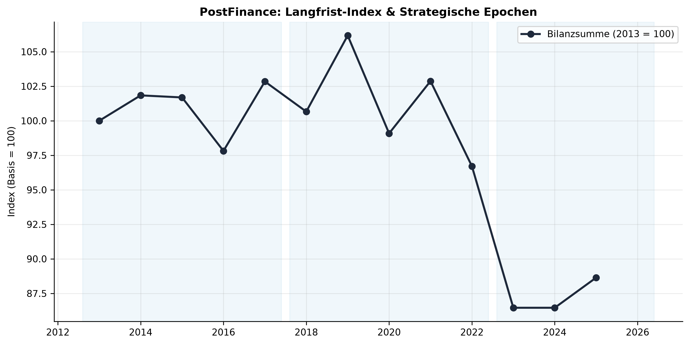
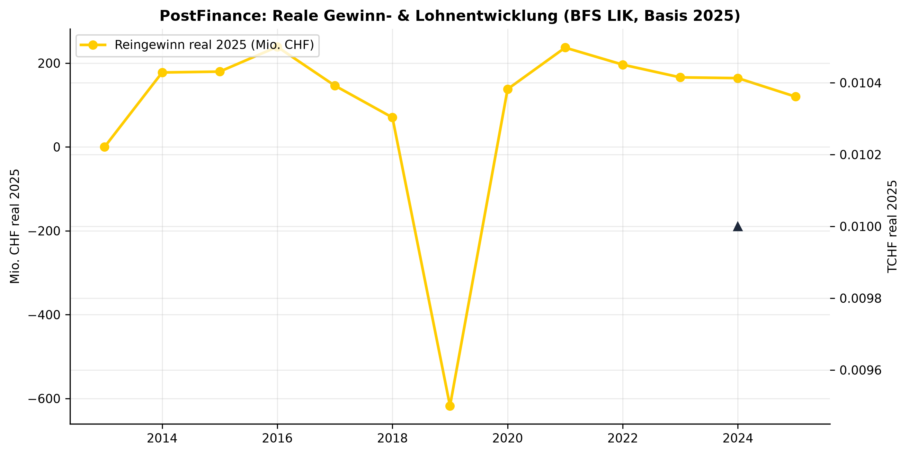

# 07 · Strategische Epochen, Governance & reale Vergütung (2013–2025): PostFinance AG

> **Preisbasis:** Sämtliche Realgrössen sind mit dem offiziellen **BFS Landesindex der Konsumentenpreise (LIK, Dez. 1982 = 100)** deterministisch auf **reale CHF 2025** deflationiert.

## 1. Management Summary & Strategische Epochen
- **Epoche 1 (2013–2017):** AG-Ausgründung & Beginn Negativzinsphase
- **Epoche 2 (2018–2022):** Margenerosion unter Kreditverbot & Gebührenumbau
- **Epoche 3 (2023–2026):** Zinswende-Erholung & Basel III final

## 2. Reale Gewinn-, Lohn- & Vergütungsentwicklung (real 2025 CHF)
| Jahr | Gewinn nom. | Gewinn real 2025 | Lohn/FTE real (TCHF) | VR real (TCHF) | CEO real (TCHF) | GL real (TCHF) |
| --- | --- | --- | --- | --- | --- | --- |
| 2013 | 0,0 | 0,0 | – | – | – | – |
| 2014 | 167,0 | 177,7 | – | – | – | – |
| 2015 | 167,0 | 179,7 | – | – | – | – |
| 2016 | 221,0 | 238,9 | – | – | – | – |
| 2017 | 136,0 | 146,3 | – | – | – | – |
| 2018 | 66,0 | 70,3 | – | – | – | – |
| 2019 | -582,0 | -617,7 | – | – | – | – |
| 2020 | 129,0 | 137,9 | – | – | – | – |
| 2021 | 223,0 | 237,0 | – | – | – | – |
| 2022 | 190,0 | 196,4 | – | – | – | – |
| 2023 | 164,0 | 166,0 | – | – | – | – |
| 2024 | 164,0 | 164,2 | 0,0 | – | – | – |
| 2025 | 120,0 | 120,0 | – | – | – | – |

## 3. Treiberanalyse & Wendepunkte
- **2013:** Ausgründung als AG unter FINMA-Aufsicht (mit Kreditverbot)
- **2023:** Zinswende-Effekt auf SNB-Guthaben & Finanzanlagen
- **2025:** Inkrafttreten Basel III final per 01.01.2025

## 4. Fazit & Ausblick
- Die gemeinsame Inflationsbereinigung auf `real 2025 CHF` ermöglicht den unverzerrten Vergleich von Produktivität, Reallöhnen und Organvergütungen über zwei Jahrzehnte.
