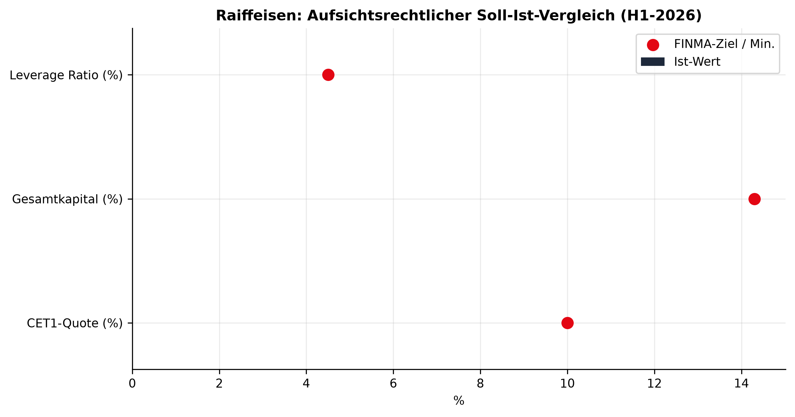
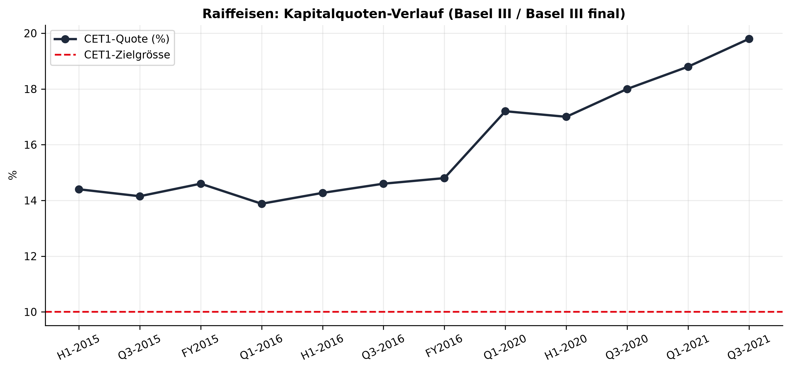

# 03 · Aufsichtsrechtliche Resilienz & Basel III: Raiffeisen Gruppe Schweiz

> **FINMA-Kategorie:** Kategorie 2 | **CET1-Zielgrösse:** 10,00 % | **Gesamtkapital-Ziel:** 14,30 %

## 1. Management Summary
- Am jüngsten Offenlegungsstichtag (**H1-2026**, Regime: *Basel III final*) beträgt die **CET1-Quote – %** (Puffer über Ziel: **– Prozentpunkte**).
- Die Gesamtkapitalquote liegt bei **– %**, die Leverage Ratio bei **– %**.
- Liquiditätsquoten: LCR **– %**, NSFR **– %** (Mindestanforderung je 100 %).

## 2. Quantitative Entwicklung (45 Stichtage)
| Periode | Regime | RWA (Mio.) | CET1 (Mio.) | CET1 % | Gesamtkap. % | Leverage % | LCR % | NSFR % |
| --- | --- | --- | --- | --- | --- | --- | --- | --- |
| H1-2015 | Basel III | 85'616'094,0 | 12'635'842,0 | 14,40 % | 16,20 % | – % | – % | – % |
| Q3-2015 | Basel III | – | 12'116,0 | 14,15 % | 16,19 % | 202'292,00 % | – % | – % |
| FY2015 | Basel III | 87'458'514,0 | 13'283'841,0 | 14,60 % | 16,40 % | – % | – % | – % |
| Q1-2016 | Basel III | – | 12'705,0 | 13,88 % | 15,28 % | 212'546,00 % | – % | – % |
| H1-2016 | Basel III | – | 12'705,0 | 14,27 % | 16,34 % | 212'546,00 % | – % | – % |
| Q3-2016 | Basel III | – | 0,0 | 14,60 % | 16,30 % | – % | – % | – % |
| FY2016 | Basel III | – | 0,0 | 14,80 % | 16,50 % | – % | – % | – % |
| Q1-2017 | Basel III | – | 0,0 | – % | – % | – % | – % | – % |
| H1-2017 | Basel III | – | 0,0 | – % | – % | – % | – % | – % |
| Q3-2017 | Basel III | – | 0,0 | – % | – % | – % | – % | – % |
| FY2017 | Basel III | – | 0,0 | – % | – % | – % | – % | – % |
| Q1-2018 | Basel III | – | 10,1 | – % | – % | – % | – % | – % |
| H1-2018 | Basel III | – | – | – % | – % | – % | – % | – % |
| Q3-2018 | Basel III | – | – | – % | – % | – % | – % | – % |
| FY2018 | Basel III | – | – | – % | – % | – % | – % | – % |
| Q1-2019 | Basel III | – | – | – % | – % | 239'641,00 % | – % | – % |
| H1-2019 | Basel III | – | – | – % | – % | – % | – % | – % |
| Q3-2019 | Basel III | – | – | – % | – % | – % | – % | – % |
| FY2019 | Basel III | – | – | – % | – % | – % | – % | – % |
| Q1-2020 | Basel III | – | 16'920,0 | 17,20 % | 18,30 % | 228'686,00 % | – % | – % |
| H1-2020 | Basel III | – | 16'959,0 | 17,00 % | 18,10 % | – % | – % | – % |
| Q3-2020 | Basel III | – | 17'085,0 | 18,00 % | 18,40 % | 237'105,00 % | – % | – % |
| FY2020 | Basel III | – | – | – % | – % | – % | – % | – % |
| Q1-2021 | Basel III | – | 18,0 | 18,80 % | 20,70 % | 6,80 % | – % | – % |
| H1-2021 | Basel III | – | – | – % | – % | – % | – % | – % |
| Q3-2021 | Basel III | – | 18,1 | 19,80 % | 22,00 % | – % | – % | – % |
| FY2021 | Basel III | – | – | – % | – % | 27,00 % | – % | 36,0 % |
| Q1-2022 | Basel III | – | – | – % | – % | 7,00 % | – % | – % |
| H1-2022 | Basel III | – | – | – % | – % | – % | – % | – % |
| Q3-2022 | Basel III | – | – | – % | – % | 7,00 % | – % | – % |
| FY2022 | Basel III | – | – | – % | – % | – % | – % | – % |
| Q1-2023 | Basel III | – | – | – % | – % | 8,00 % | – % | – % |
| H1-2023 | Basel III | – | – | – % | – % | – % | – % | – % |
| Q3-2023 | Basel III | – | – | – % | – % | 8,00 % | – % | – % |
| FY2023 | Basel III | – | – | – % | – % | – % | – % | – % |
| Q1-2024 | Basel III | – | – | – % | – % | 8,00 % | – % | – % |
| H1-2024 | Basel III | – | – | – % | – % | – % | – % | – % |
| Q3-2024 | Basel III | – | – | – % | – % | 8,00 % | – % | – % |
| FY2024 | Basel III | – | – | – % | – % | – % | – % | – % |
| Q1-2025 | Basel III final | – | – | – % | – % | 9,00 % | – % | – % |
| H1-2025 | Basel III final | – | – | – % | – % | – % | – % | – % |
| Q3-2025 | Basel III final | – | – | – % | – % | – % | – % | – % |
| FY2025 | Basel III final | – | – | – % | – % | – % | – % | – % |
| Q1-2026 | Basel III final | – | – | – % | – % | – % | – % | – % |
| H1-2026 | Basel III final | – | – | – % | – % | – % | – % | – % |

## 3. Treiberanalyse & Wendepunkte
- Mit Inkrafttreten von **Basel III final** ab 01.01.2025 verändern sich risikogewichtete Aktiven (RWA) und RWA-Dichte durch angepasste Standard- bzw. Output-Floor-Vorgaben.

## 4. Fazit & Ausblick
- Die Eigenmittel- und Liquiditätspuffer übertreffen die regulatorischen Mindestanforderungen für FINMA-Kategorie 2 deutlich.
