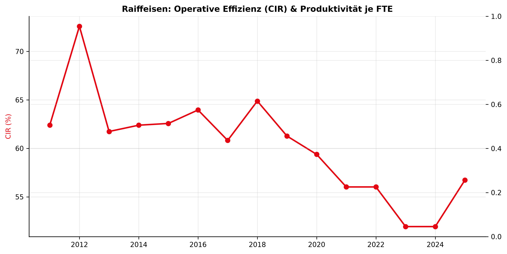

# 04 · Operative Effizienz & Transformation (2011–2025): Raiffeisen Gruppe Schweiz

## 1. Management Summary
- Die Cost-Income-Ratio (CIR) liegt im Jahr 2025 bei **56,72 %** (vs. 62,39 % im Jahr 2011), die Eigenkapitalrendite (ROE) bei **5,08 %**.
- Der Personalbestand umfasst 2025 **– FTE** bei einem Ertrag pro Vollzeitstelle von **– TCHF**.

## 2. Quantitative Entwicklung
| Jahr | CIR % | ROE % | FTE | Ertrag/FTE (TCHF) | Bilanz/FTE (Mio.) | Filialen |
| --- | --- | --- | --- | --- | --- | --- |
| 2011 | 62,39 % | 6,03 % | – | – | – | – |
| 2012 | 72,59 % | 6,05 % | – | – | – | – |
| 2013 | 61,74 % | 6,40 % | – | – | – | – |
| 2014 | 62,39 % | 6,29 % | – | – | – | – |
| 2015 | 62,57 % | 6,07 % | – | – | – | – |
| 2016 | 63,96 % | 5,24 % | – | – | – | – |
| 2017 | 60,82 % | 5,84 % | – | – | – | – |
| 2018 | 64,88 % | 3,27 % | – | – | – | – |
| 2019 | 61,27 % | 4,79 % | – | – | – | – |
| 2020 | 59,38 % | 4,67 % | – | – | – | – |
| 2021 | 56,02 % | 5,57 % | – | – | – | – |
| 2022 | 56,02 % | 5,57 % | – | – | – | – |
| 2023 | 51,93 % | 6,22 % | – | – | – | – |
| 2024 | 51,93 % | 6,22 % | – | – | – | – |
| 2025 | 56,72 % | 5,08 % | – | – | – | – |

## 3. Treiberanalyse & Wendepunkte
- **2015:** Umstellung auf FINMA-RVB
- **2018:** Governance-Reform & strategische Neuausrichtung
- **2025:** Inkrafttreten Basel III final per 01.01.2025

## 4. Fazit & Ausblick
- Digitalisierung und Skalierung steigern Bilanzsumme und Geschäftsvolumen pro Vollzeitstelle langfristig.
