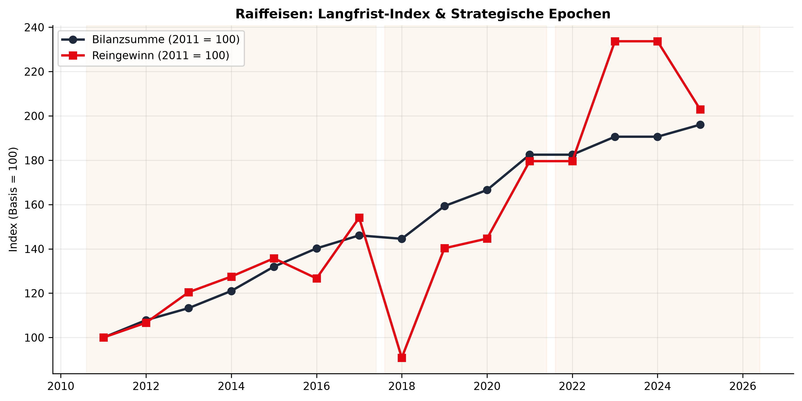
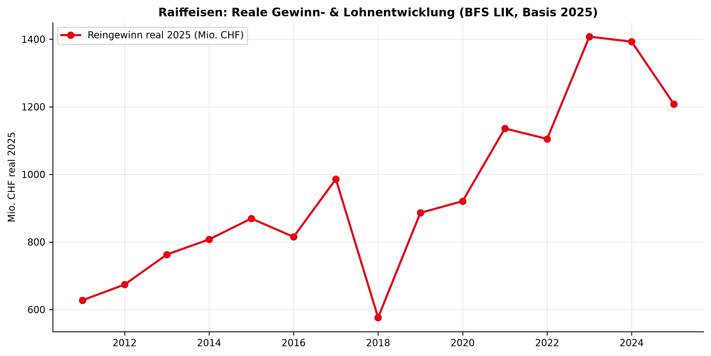

# 07 · Strategische Epochen, Governance & reale Vergütung (2011–2025): Raiffeisen Gruppe Schweiz

> **Preisbasis:** Sämtliche Realgrössen sind mit dem offiziellen **BFS Landesindex der Konsumentenpreise (LIK, Dez. 1982 = 100)** deterministisch auf **reale CHF 2025** deflationiert.

## 1. Management Summary & Strategische Epochen
- **Epoche 1 (2011–2017):** Hypothekar-Expansion & D-SIB-Einstufung
- **Epoche 2 (2018–2021):** Governance-Reform & Kapitalstärkung
- **Epoche 3 (2022–2026):** Zinswende & Basel III final

## 2. Reale Gewinn-, Lohn- & Vergütungsentwicklung (real 2025 CHF)
| Jahr | Gewinn nom. | Gewinn real 2025 | Lohn/FTE real (TCHF) | VR real (TCHF) | CEO real (TCHF) | GL real (TCHF) |
| --- | --- | --- | --- | --- | --- | --- |
| 2011 | 595,3 | 627,4 | – | – | – | – |
| 2012 | 635,0 | 673,9 | – | – | – | – |
| 2013 | 717,0 | 762,9 | – | – | – | – |
| 2014 | 759,0 | 807,5 | – | – | – | – |
| 2015 | 808,0 | 869,5 | – | – | – | – |
| 2016 | 754,0 | 815,0 | – | – | – | – |
| 2017 | 917,0 | 986,2 | – | – | – | – |
| 2018 | 541,0 | 576,3 | – | – | – | – |
| 2019 | 835,0 | 886,2 | – | – | – | – |
| 2020 | 861,0 | 920,7 | – | – | – | – |
| 2021 | 1'069,0 | 1'135,9 | – | – | – | – |
| 2022 | 1'069,0 | 1'104,8 | – | – | – | – |
| 2023 | 1'391,0 | 1'407,6 | – | – | – | – |
| 2024 | 1'391,0 | 1'392,6 | – | – | – | – |
| 2025 | 1'208,0 | 1'208,0 | – | – | – | – |

## 3. Treiberanalyse & Wendepunkte
- **2015:** Umstellung auf FINMA-RVB
- **2018:** Governance-Reform & strategische Neuausrichtung
- **2025:** Inkrafttreten Basel III final per 01.01.2025

## 4. Fazit & Ausblick
- Die gemeinsame Inflationsbereinigung auf `real 2025 CHF` ermöglicht den unverzerrten Vergleich von Produktivität, Reallöhnen und Organvergütungen über zwei Jahrzehnte.
