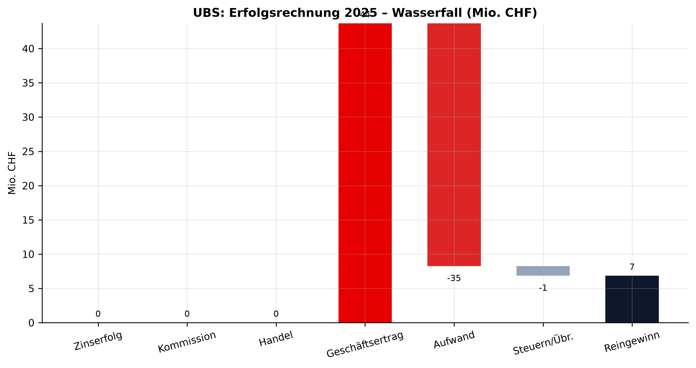
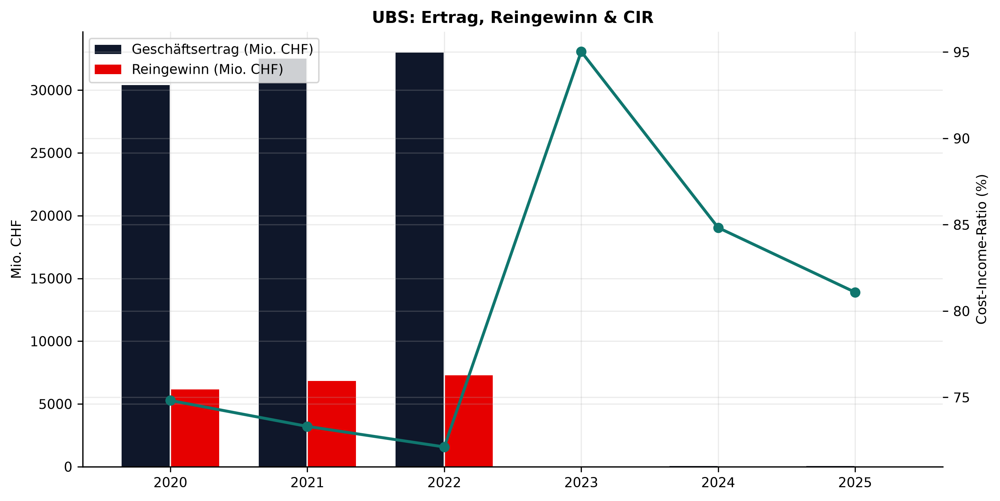

# 01 · Zinszyklen & Ertragsarchitektur (2020–2025): UBS Group AG

> **Scope:** `consolidated` | **Standard:** `IFRS` | **Währung:** Mio. CHF (harmonisierte Zeitreihe)

## 1. Management Summary
- Im Zeitraum **2020–2025** entwickelte sich der Geschäftsertrag von **30'411,0 Mio. CHF** auf **43,7 Mio. CHF** (CAGR **-73,00 % p. a.**).
- Der Reingewinn erreichte im jüngsten Geschäftsjahr 2025 **6,8 Mio. CHF** (nach 6'156,0 Mio. CHF im Jahr 2020).
- Der Netto-Zinserfolg trägt aktuell **– %** zum Gesamtertrag bei, das Kommissionsgeschäft **– %** und das Handelsgeschäft **– %**.

## 2. Quantitative Entwicklung
| Jahr | Zinserfolg (Mio.) | Kommission (Mio.) | Handel (Mio.) | Geschäftsertrag | Geschäftserfolg | Reingewinn | Zinsanteil |
| --- | --- | --- | --- | --- | --- | --- | --- |
| 2020 | – | – | – | 30'411,0 | – | 6'156,0 | – % |
| 2021 | – | – | – | 32'496,0 | – | 6'818,0 | – % |
| 2022 | – | – | – | 32'997,0 | – | 7'284,0 | – % |
| 2023 | – | – | – | 36,7 | – | 25,0 | – % |
| 2024 | – | – | – | 42,8 | – | 4,5 | – % |
| 2025 | – | – | – | 43,7 | – | 6,8 | – % |

## 3. Treiberanalyse & Wendepunkte
- **2023:** Akquisition Credit Suisse (Negative Goodwill USD 27,7 Mrd. als Einmaleffekt)
- **2025:** Basel III final & G-SIB-Kapitalanforderungen

## 4. Fazit & Ausblick
- Die Ertragsarchitektur von UBS spiegelt die Zinszyklen (Negativzinsphase 2015–2022, Zinswende 2022–2024, Zinssenkungen ab 2025) unmittelbar wider.
