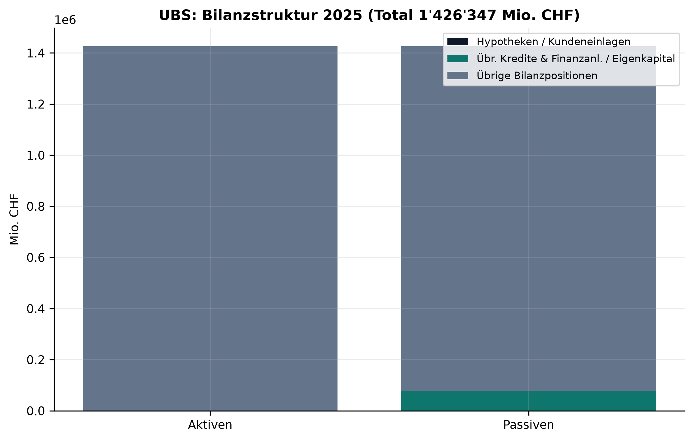
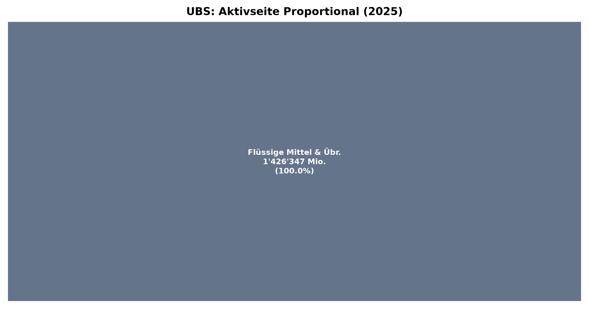
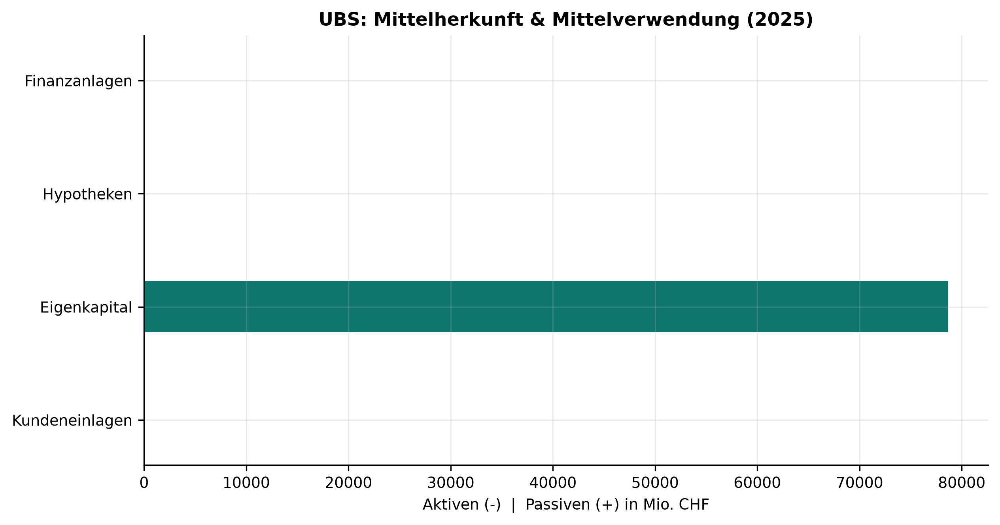
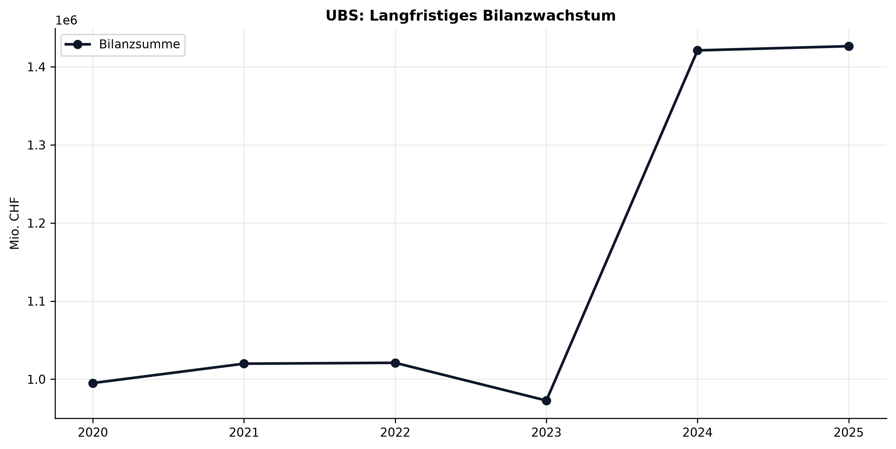

# 02 · Bilanzwachstum, Hypotheken & Refinanzierung (2020–2025): UBS Group AG

## 1. Management Summary
- Die Bilanzsumme wuchs von **995'064,0 Mio. CHF** (2020) auf **1'426'346,6 Mio. CHF** (2025, CAGR **7,47 %**).
- Die Hypothekarforderungen machen im Jahr 2025 **– %** der Bilanzsumme aus.
- Die Kundeneinlagen belaufen sich 2025 auf **– Mio. CHF**, das Eigenkapital auf **78'655,9 Mio. CHF** (Eigenkapitalquote **5,51 %**).

## 2. Quantitative Entwicklung
| Jahr | Bilanzsumme | Hypotheken | Finanzanlagen | Kundeneinlagen | Eigenkapital | Deckungsgrad |
| --- | --- | --- | --- | --- | --- | --- |
| 2020 | 995'064,0 | – | – | – | 52'543,0 | – % |
| 2021 | 1'019'875,0 | – | – | – | 55'378,0 | – % |
| 2022 | 1'020'985,0 | – | – | – | 52'582,0 | – % |
| 2023 | 972'671,9 | – | – | – | 72,5 | – % |
| 2024 | 1'420'976,0 | – | – | – | 85'786,3 | – % |
| 2025 | 1'426'346,6 | – | – | – | 78'655,9 | – % |

## 3. Treiberanalyse & Wendepunkte
- **2023:** Akquisition Credit Suisse (Negative Goodwill USD 27,7 Mrd. als Einmaleffekt)
- **2025:** Basel III final & G-SIB-Kapitalanforderungen

## 4. Fazit & Ausblick
- Refinanzierungsbasis und Bilanzstruktur bleiben eng an Kundeneinlagen und die jeweilige Geschäftsmodell-Spezialisierung gekoppelt.
