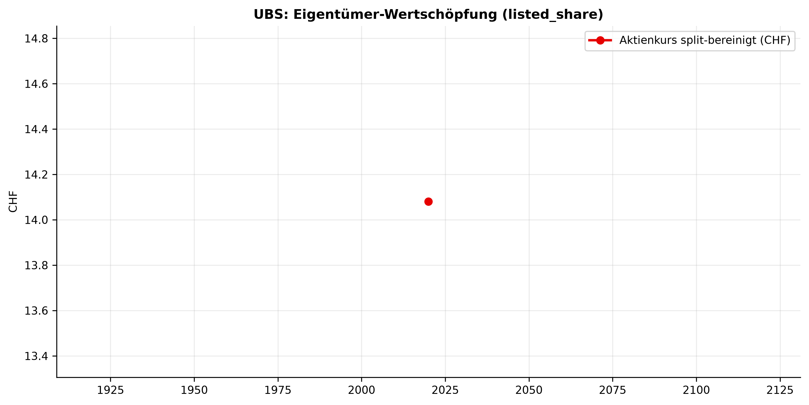

# 05 · Aktie, Dividenden & Wertschöpfung (2020–2025): UBS Group AG

> **Eigentümer-Modus:** `listed_share` | **Staatsgarantie:** Keine | **Ticker:** `UBSG`

## 1. Management Summary
- Im Geschäftsjahr 2025 erwirtschaftete UBS einen Gewinn von **6,8 Mio. CHF** bei einem Eigenkapital von **78'655,9 Mio. CHF**.
- Die Ausschüttungs- und Kapitalstruktur folgt dem spezifischen Governance-Modell (`listed_share`).

## 2. Quantitative Entwicklung
| Jahr | Reingewinn (Mio.) | Eigenkapital (Mio.) | Aktienkurs (split-ber.) | Dividende/Aktie | Div.-Rendite | Öff. Ablieferung (Mio.) |
| --- | --- | --- | --- | --- | --- | --- |
| 2020 | 6'156,0 | 52'543,0 | 14.08 | – | – % | – |
| 2021 | 6'818,0 | 55'378,0 | – | – | – % | – |
| 2022 | 7'284,0 | 52'582,0 | – | – | – % | – |
| 2023 | 25,0 | 72,5 | – | – | – % | – |
| 2024 | 4,5 | 85'786,3 | – | – | – % | – |
| 2025 | 6,8 | 78'655,9 | – | – | – % | – |

## 3. Treiberanalyse & Wendepunkte
- Bei kotierten Instituten mit Aktiensplits (z. B. BCV 1:10 im Jahr 2020) sind sämtliche historischen Kurs- und Dividendenreihen deterministisch split-bereinigt.

## 4. Fazit & Ausblick
- Stabile Ertragskraft sichert langfristig Dividendenkontinuität bzw. verlässliche Ablieferungen an Kanton, Post oder Genossenschafter.
