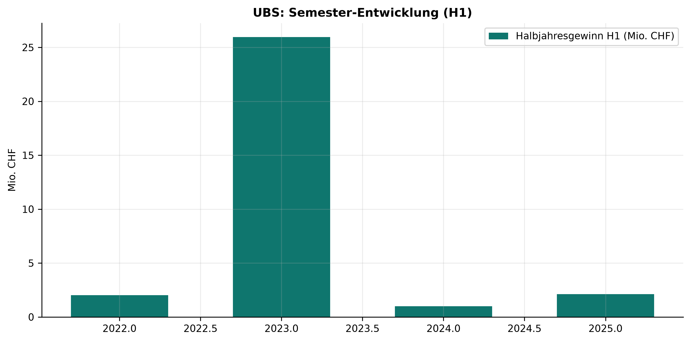

# 06 · Unterjährige Dynamik (Semesterberichte): UBS Group AG

## 1. Management Summary
- Vorliegen von **4 Halbjahresabschlüssen**; jüngster Stichtag ist **H1-2025** mit einem Geschäftsertrag von **10,7 Mio. CHF** und einem Halbjahresgewinn von **2,1 Mio. CHF**.

## 2. Quantitative Entwicklung
| Periode | Bilanzsumme | Zinserfolg H1 | Geschäftsertrag H1 | Geschäftserfolg H1 | Reingewinn H1 |
| --- | --- | --- | --- | --- | --- |
| H1-2022 | 1'029,1 | – | 8,5 | – | 2,0 |
| H1-2023 | 922'441'965,2 | – | 8,6 | – | 25,9 |
| H1-2024 | 1'414,6 | – | 10,5 | – | 1,0 |
| H1-2025 | 1'472,9 | – | 10,7 | – | 2,1 |

## 3. Treiberanalyse & Wendepunkte
- Der Vergleich von H1-Werten gegen die jeweiligen Gesamtjahresergebnisse (FY) zeigt die saisonale Ertragsverteilung und Reservebildung im zweiten Halbjahr.

## 4. Fazit & Ausblick
- Die Halbjahresberichte ermöglichen ein zeitnahes Monitoring der Zinsmargen- und Kreditvolumen-Dynamik bis H1-2026.
