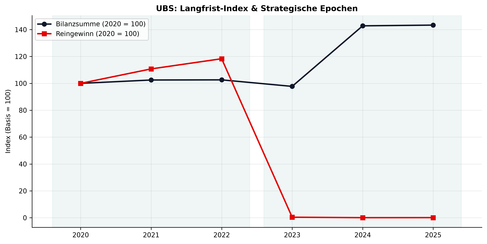
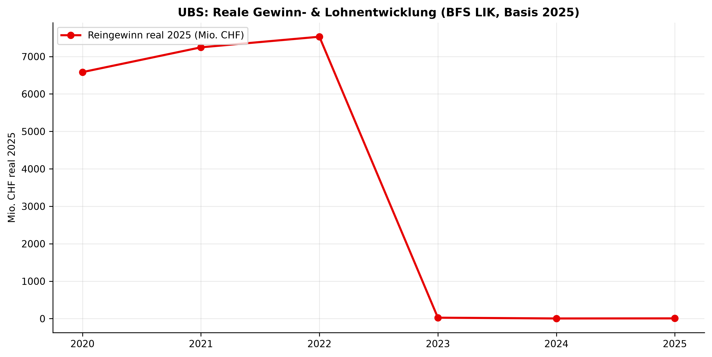

# 07 · Strategische Epochen, Governance & reale Vergütung (2020–2025): UBS Group AG

> **Preisbasis:** Sämtliche Realgrössen sind mit dem offiziellen **BFS Landesindex der Konsumentenpreise (LIK, Dez. 1982 = 100)** deterministisch auf **reale CHF 2025** deflationiert.

## 1. Management Summary & Strategische Epochen
- **Epoche 1 (2020–2022):** Globale Wealth-Management-Konsolidierung
- **Epoche 2 (2023–2025):** Credit-Suisse-Übernahme, Integration & Basel III final

## 2. Reale Gewinn-, Lohn- & Vergütungsentwicklung (real 2025 CHF)
| Jahr | Gewinn nom. | Gewinn real 2025 | Lohn/FTE real (TCHF) | VR real (TCHF) | CEO real (TCHF) | GL real (TCHF) |
| --- | --- | --- | --- | --- | --- | --- |
| 2020 | 6'156,0 | 6'582,7 | – | – | – | – |
| 2021 | 6'818,0 | 7'244,9 | – | – | – | – |
| 2022 | 7'284,0 | 7'528,0 | – | – | – | – |
| 2023 | 25,0 | 25,3 | – | – | – | – |
| 2024 | 4,5 | 4,5 | – | – | – | – |
| 2025 | 6,8 | 6,8 | – | – | – | – |

## 3. Treiberanalyse & Wendepunkte
- **2023:** Akquisition Credit Suisse (Negative Goodwill USD 27,7 Mrd. als Einmaleffekt)
- **2025:** Basel III final & G-SIB-Kapitalanforderungen

## 4. Fazit & Ausblick
- Die gemeinsame Inflationsbereinigung auf `real 2025 CHF` ermöglicht den unverzerrten Vergleich von Produktivität, Reallöhnen und Organvergütungen über zwei Jahrzehnte.
