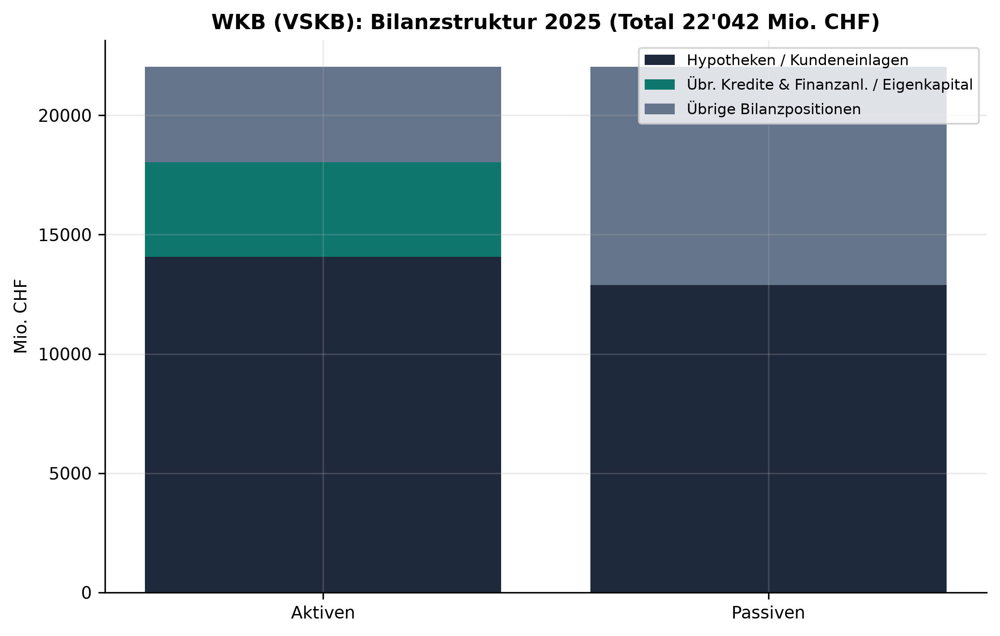
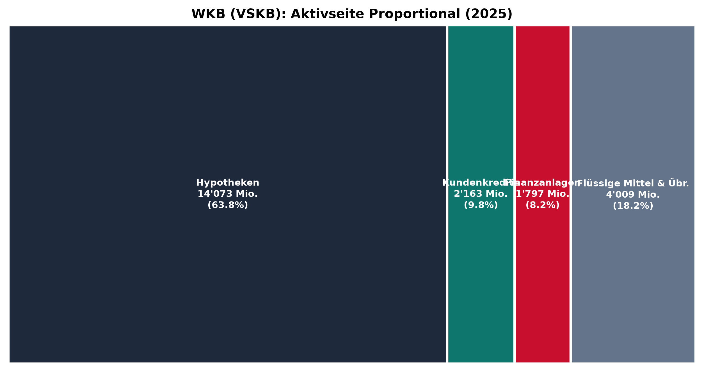
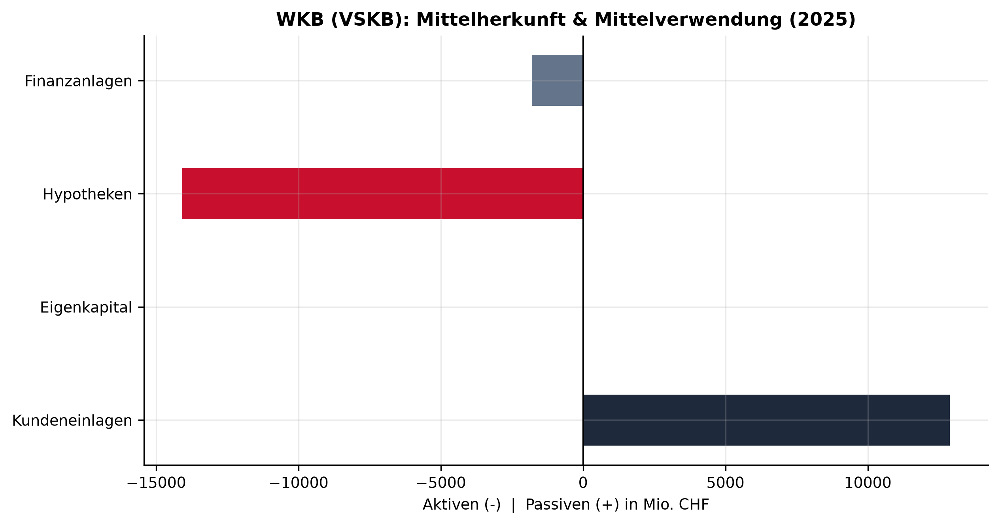
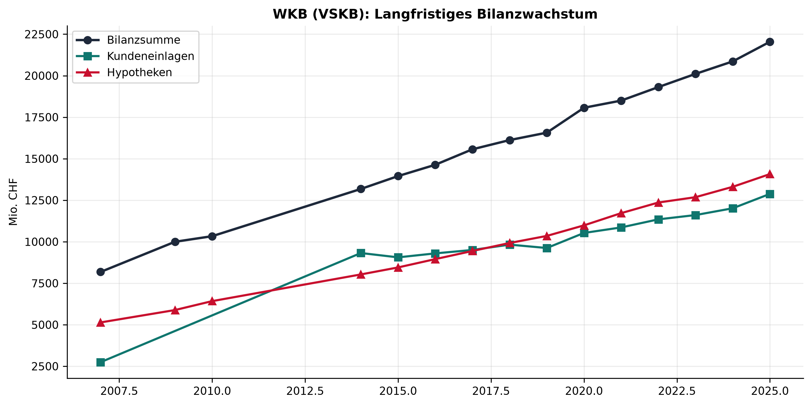

# 02 · Bilanzwachstum, Hypotheken & Refinanzierung (2007–2025): Walliser Kantonalbank (BCVs)

## 1. Management Summary
- Die Bilanzsumme wuchs von **8'179,4 Mio. CHF** (2007) auf **22'042,2 Mio. CHF** (2025, CAGR **5,66 %**).
- Die Hypothekarforderungen machen im Jahr 2025 **63,9 %** der Bilanzsumme aus.
- Die Kundeneinlagen belaufen sich 2025 auf **12'880,0 Mio. CHF**, das Eigenkapital auf **– Mio. CHF** (Eigenkapitalquote **– %**).

## 2. Quantitative Entwicklung
| Jahr | Bilanzsumme | Hypotheken | Finanzanlagen | Kundeneinlagen | Eigenkapital | Deckungsgrad |
| --- | --- | --- | --- | --- | --- | --- |
| 2007 | 8'179,4 | 5'138,6 | 274,0 | 2'744,3 | – | 40,1 % |
| 2009 | 9'995,7 | 5'883,6 | 445,4 | – | – | – % |
| 2010 | 10'332,1 | 6'421,5 | 434,6 | – | – | – % |
| 2014 | 13'178,0 | 8'029,4 | 398,9 | 9'318,6 | – | 116,1 % |
| 2015 | 13'952,3 | 8'450,8 | 287,6 | 9'057,7 | – | 107,2 % |
| 2016 | 14'633,2 | 8'951,7 | 337,5 | 9'297,0 | – | 103,9 % |
| 2017 | 15'566,4 | 9'442,1 | 290,1 | 9'502,8 | – | 100,6 % |
| 2018 | 16'121,7 | 9'922,9 | 351,4 | 9'824,2 | – | 99,0 % |
| 2019 | 16'567,6 | 10'349,1 | 358,5 | 9'620,4 | – | 93,0 % |
| 2020 | 18'067,9 | 10'984,9 | 404,3 | 10'527,8 | – | 79,9 % |
| 2021 | 18'499,8 | 11'721,1 | 448,7 | 10'860,5 | – | 79,1 % |
| 2022 | 19'313,5 | 12'360,5 | 789,3 | 11'346,5 | – | 78,7 % |
| 2023 | 20'109,1 | 12'682,9 | 1'422,2 | 11'605,6 | – | 78,1 % |
| 2024 | 20'859,8 | 13'306,5 | 1'471,0 | 12'013,8 | – | 77,4 % |
| 2025 | 22'042,2 | 14'073,5 | 1'796,8 | 12'880,0 | – | 79,3 % |

## 3. Treiberanalyse & Wendepunkte
- **2015:** Umstellung auf FINMA-RVB
- **2025:** Inkrafttreten Basel III final per 01.01.2025

## 4. Fazit & Ausblick
- Refinanzierungsbasis und Bilanzstruktur bleiben eng an Kundeneinlagen und die jeweilige Geschäftsmodell-Spezialisierung gekoppelt.
