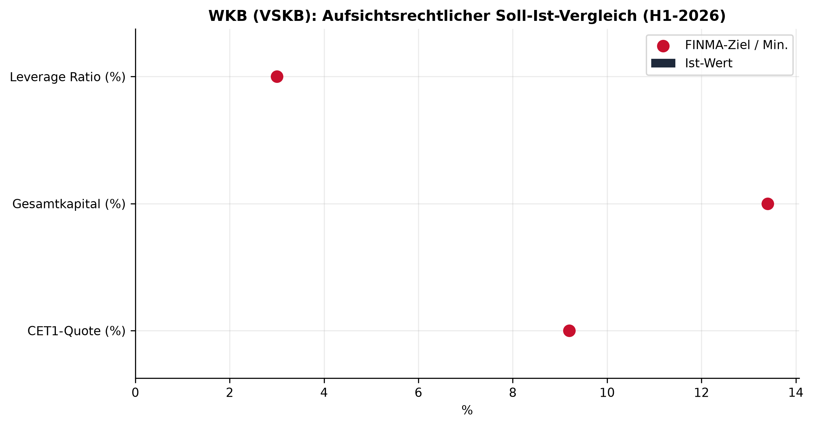
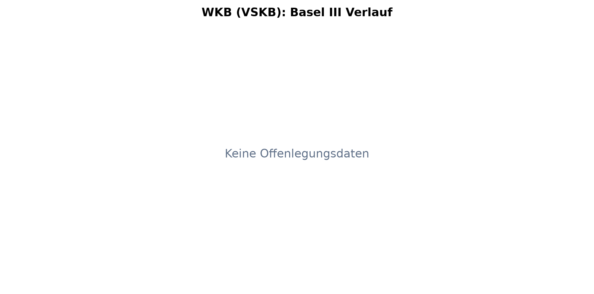

# 03 · Aufsichtsrechtliche Resilienz & Basel III: Walliser Kantonalbank (BCVs)

> **FINMA-Kategorie:** Kategorie 3 | **CET1-Zielgrösse:** 9,20 % | **Gesamtkapital-Ziel:** 13,40 %

## 1. Management Summary
- Am jüngsten Offenlegungsstichtag (**H1-2026**, Regime: *Basel III final*) beträgt die **CET1-Quote – %** (Puffer über Ziel: **– Prozentpunkte**).
- Die Gesamtkapitalquote liegt bei **– %**, die Leverage Ratio bei **– %**.
- Liquiditätsquoten: LCR **– %**, NSFR **– %** (Mindestanforderung je 100 %).

## 2. Quantitative Entwicklung (13 Stichtage)
| Periode | Regime | RWA (Mio.) | CET1 (Mio.) | CET1 % | Gesamtkap. % | Leverage % | LCR % | NSFR % |
| --- | --- | --- | --- | --- | --- | --- | --- | --- |
| H1-2020 | Basel III | – | – | – % | – % | – % | – % | – % |
| FY2020 | Basel III | – | – | – % | – % | – % | – % | – % |
| H1-2021 | Basel III | – | – | – % | – % | – % | – % | – % |
| FY2021 | Basel III | – | – | – % | – % | – % | – % | – % |
| H1-2022 | Basel III | – | – | – % | – % | – % | – % | – % |
| FY2022 | Basel III | – | – | – % | – % | – % | – % | – % |
| H1-2023 | Basel III | – | – | – % | – % | – % | – % | – % |
| FY2023 | Basel III | – | – | – % | – % | – % | – % | – % |
| H1-2024 | Basel III | – | – | – % | – % | – % | – % | – % |
| FY2024 | Basel III | – | – | – % | – % | – % | – % | – % |
| H1-2025 | Basel III final | – | – | – % | – % | – % | – % | – % |
| FY2025 | Basel III final | – | – | – % | – % | – % | – % | – % |
| H1-2026 | Basel III final | – | – | – % | – % | – % | – % | – % |

## 3. Treiberanalyse & Wendepunkte
- Mit Inkrafttreten von **Basel III final** ab 01.01.2025 verändern sich risikogewichtete Aktiven (RWA) und RWA-Dichte durch angepasste Standard- bzw. Output-Floor-Vorgaben.

## 4. Fazit & Ausblick
- Die Eigenmittel- und Liquiditätspuffer übertreffen die regulatorischen Mindestanforderungen für FINMA-Kategorie 3 deutlich.
