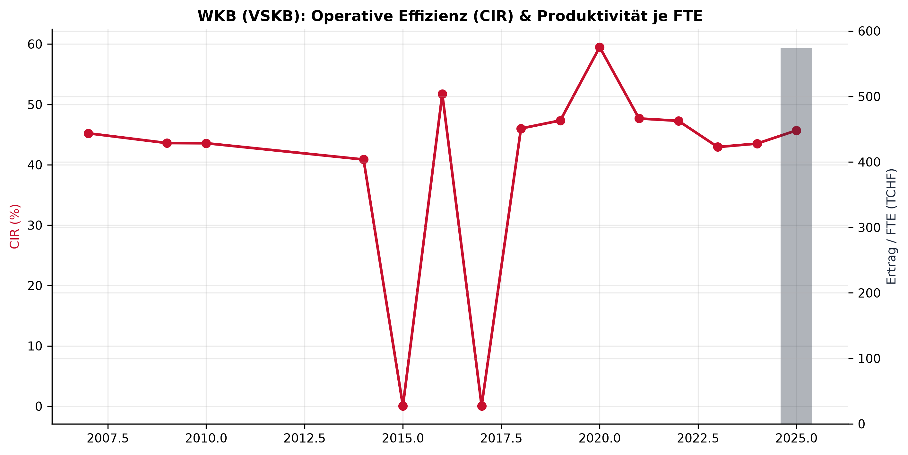

# 04 · Operative Effizienz & Transformation (2007–2025): Walliser Kantonalbank (BCVs)

## 1. Management Summary
- Die Cost-Income-Ratio (CIR) liegt im Jahr 2025 bei **45,69 %** (vs. 45,22 % im Jahr 2007), die Eigenkapitalrendite (ROE) bei **– %**.
- Der Personalbestand umfasst 2025 **494,0 FTE** bei einem Ertrag pro Vollzeitstelle von **574,0 TCHF**.

## 2. Quantitative Entwicklung
| Jahr | CIR % | ROE % | FTE | Ertrag/FTE (TCHF) | Bilanz/FTE (Mio.) | Filialen |
| --- | --- | --- | --- | --- | --- | --- |
| 2007 | 45,22 % | – % | – | – | – | – |
| 2009 | 43,60 % | – % | – | – | – | – |
| 2010 | 43,57 % | – % | – | – | – | – |
| 2014 | 40,87 % | – % | – | – | – | – |
| 2015 | 0,05 % | – % | – | – | – | – |
| 2016 | 51,72 % | – % | – | – | – | – |
| 2017 | 0,07 % | – % | – | – | – | – |
| 2018 | 46,01 % | – % | – | – | – | – |
| 2019 | 47,34 % | – % | – | – | – | – |
| 2020 | 59,49 % | – % | – | – | – | – |
| 2021 | 47,67 % | – % | – | – | – | – |
| 2022 | 47,28 % | – % | – | – | – | – |
| 2023 | 42,94 % | – % | – | – | – | – |
| 2024 | 43,51 % | – % | – | – | – | – |
| 2025 | 45,69 % | – % | 494,0 | 574,0 | 44,62 | – |

## 3. Treiberanalyse & Wendepunkte
- **2015:** Umstellung auf FINMA-RVB
- **2025:** Inkrafttreten Basel III final per 01.01.2025

## 4. Fazit & Ausblick
- Digitalisierung und Skalierung steigern Bilanzsumme und Geschäftsvolumen pro Vollzeitstelle langfristig.
