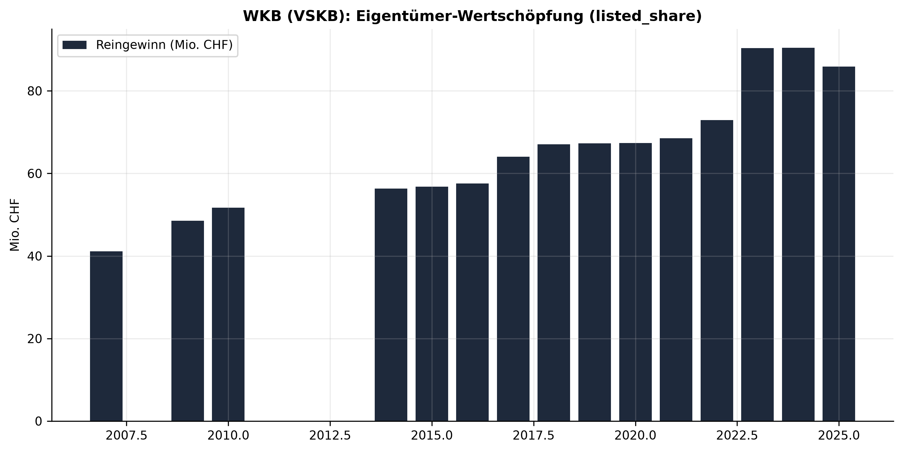

# 05 · Aktie, Dividenden & Wertschöpfung (2007–2025): Walliser Kantonalbank (BCVs)

> **Eigentümer-Modus:** `listed_share` | **Staatsgarantie:** Ja | **Ticker:** `WKB`

## 1. Management Summary
- Im Geschäftsjahr 2025 erwirtschaftete WKB (VSKB) einen Gewinn von **85,9 Mio. CHF** bei einem Eigenkapital von **– Mio. CHF**.
- Die Ausschüttungs- und Kapitalstruktur folgt dem spezifischen Governance-Modell (`listed_share`).

## 2. Quantitative Entwicklung
| Jahr | Reingewinn (Mio.) | Eigenkapital (Mio.) | Aktienkurs (split-ber.) | Dividende/Aktie | Div.-Rendite | Öff. Ablieferung (Mio.) |
| --- | --- | --- | --- | --- | --- | --- |
| 2007 | 41,1 | – | – | – | – % | – |
| 2009 | 48,5 | – | – | – | – % | – |
| 2010 | 51,7 | – | – | – | – % | – |
| 2014 | 56,3 | – | – | – | – % | – |
| 2015 | 56,8 | – | – | – | – % | – |
| 2016 | 57,5 | – | – | – | – % | – |
| 2017 | 64,0 | – | – | – | – % | – |
| 2018 | 67,1 | – | – | – | – % | – |
| 2019 | 67,3 | – | – | – | – % | – |
| 2020 | 67,4 | – | – | – | – % | – |
| 2021 | 68,5 | – | – | – | – % | – |
| 2022 | 72,9 | – | – | – | – % | – |
| 2023 | 90,4 | – | – | – | – % | – |
| 2024 | 90,5 | – | – | – | – % | – |
| 2025 | 85,9 | – | – | – | – % | – |

## 3. Treiberanalyse & Wendepunkte
- Bei kotierten Instituten mit Aktiensplits (z. B. BCV 1:10 im Jahr 2020) sind sämtliche historischen Kurs- und Dividendenreihen deterministisch split-bereinigt.

## 4. Fazit & Ausblick
- Stabile Ertragskraft sichert langfristig Dividendenkontinuität bzw. verlässliche Ablieferungen an Kanton, Post oder Genossenschafter.
