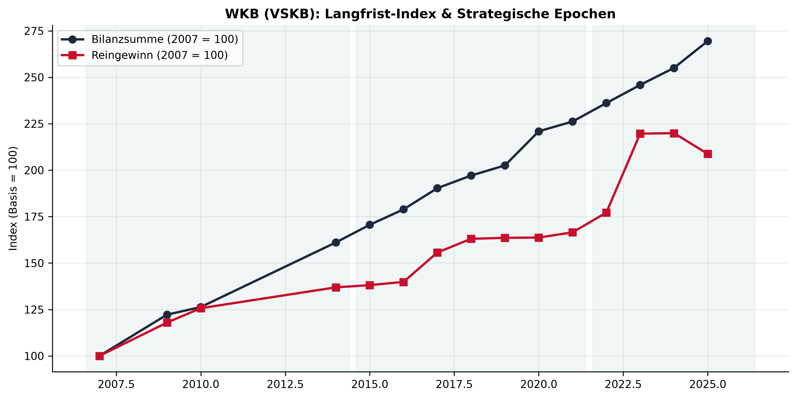
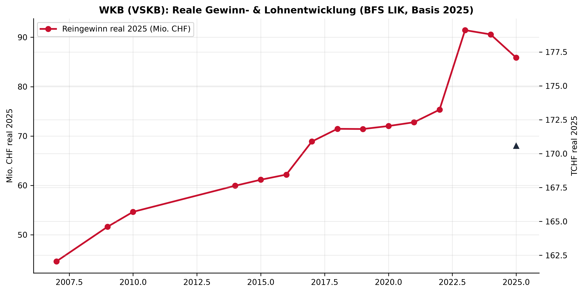

# 07 · Strategische Epochen, Governance & reale Vergütung (2007–2025): Walliser Kantonalbank (BCVs)

> **Preisbasis:** Sämtliche Realgrössen sind mit dem offiziellen **BFS Landesindex der Konsumentenpreise (LIK, Dez. 1982 = 100)** deterministisch auf **reale CHF 2025** deflationiert.

## 1. Management Summary & Strategische Epochen
- **Epoche 1 (2007–2014):** Regionales Wachstum & Finanzkrise
- **Epoche 2 (2015–2021):** SNB-Negativzinsen & Kapitalstärkung
- **Epoche 3 (2022–2026):** Zinswende & Basel III final

## 2. Reale Gewinn-, Lohn- & Vergütungsentwicklung (real 2025 CHF)
| Jahr | Gewinn nom. | Gewinn real 2025 | Lohn/FTE real (TCHF) | VR real (TCHF) | CEO real (TCHF) | GL real (TCHF) |
| --- | --- | --- | --- | --- | --- | --- |
| 2007 | 41,1 | 44,6 | – | – | – | – |
| 2009 | 48,5 | 51,6 | – | – | – | – |
| 2010 | 51,7 | 54,6 | – | – | – | – |
| 2014 | 56,3 | 59,9 | – | – | – | – |
| 2015 | 56,8 | 61,1 | – | – | – | – |
| 2016 | 57,5 | 62,2 | – | – | – | – |
| 2017 | 64,0 | 68,9 | – | – | – | – |
| 2018 | 67,1 | 71,5 | – | – | – | – |
| 2019 | 67,3 | 71,4 | – | – | – | – |
| 2020 | 67,4 | 72,0 | – | – | – | – |
| 2021 | 68,5 | 72,8 | – | – | – | – |
| 2022 | 72,9 | 75,3 | – | – | – | – |
| 2023 | 90,4 | 91,4 | – | – | – | – |
| 2024 | 90,5 | 90,6 | – | – | – | – |
| 2025 | 85,9 | 85,9 | 170,6 | – | – | – |

## 3. Treiberanalyse & Wendepunkte
- **2015:** Umstellung auf FINMA-RVB
- **2025:** Inkrafttreten Basel III final per 01.01.2025

## 4. Fazit & Ausblick
- Die gemeinsame Inflationsbereinigung auf `real 2025 CHF` ermöglicht den unverzerrten Vergleich von Produktivität, Reallöhnen und Organvergütungen über zwei Jahrzehnte.
