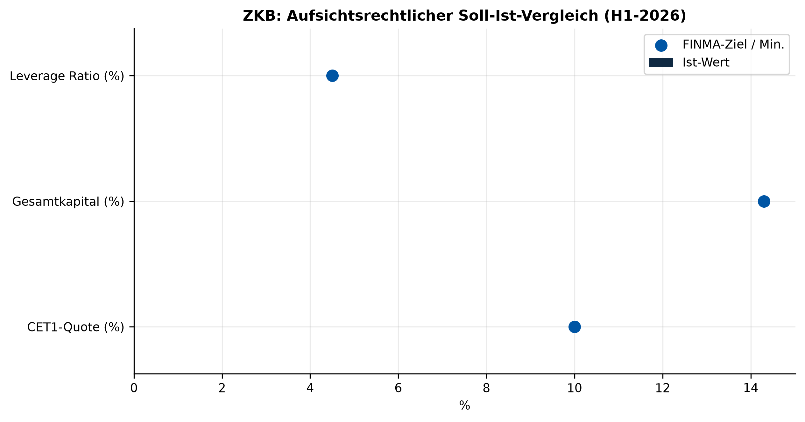
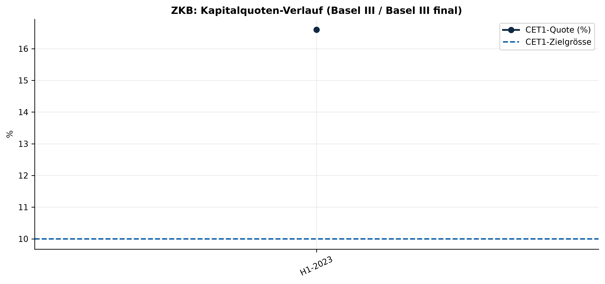

# 03 · Aufsichtsrechtliche Resilienz & Basel III: Zürcher Kantonalbank

> **FINMA-Kategorie:** Kategorie 2 | **CET1-Zielgrösse:** 10,00 % | **Gesamtkapital-Ziel:** 14,30 %

## 1. Management Summary
- Am jüngsten Offenlegungsstichtag (**H1-2026**, Regime: *Basel III final*) beträgt die **CET1-Quote – %** (Puffer über Ziel: **– Prozentpunkte**).
- Die Gesamtkapitalquote liegt bei **– %**, die Leverage Ratio bei **– %**.
- Liquiditätsquoten: LCR **– %**, NSFR **– %** (Mindestanforderung je 100 %).

## 2. Quantitative Entwicklung (44 Stichtage)
| Periode | Regime | RWA (Mio.) | CET1 (Mio.) | CET1 % | Gesamtkap. % | Leverage % | LCR % | NSFR % |
| --- | --- | --- | --- | --- | --- | --- | --- | --- |
| Q1-2014 | Basel III | – | – | – % | – % | 2'014,00 % | – % | – % |
| FY2014 | Basel III | – | – | – % | – % | 2,21 % | – % | – % |
| Q1-2015 | Basel III | – | – | – % | – % | 177'848,00 % | – % | – % |
| H1-2015 | Basel III | – | – | – % | – % | – % | – % | – % |
| Q3-2015 | Basel III | – | – | – % | – % | – % | – % | – % |
| Q1-2016 | Basel III | – | – | – % | – % | – % | – % | – % |
| H1-2016 | Basel III | – | – | – % | – % | – % | – % | – % |
| Q3-2016 | Basel III | – | – | – % | – % | – % | – % | – % |
| FY2016 | Basel III | – | – | – % | – % | – % | – % | – % |
| Q1-2017 | Basel III | – | – | – % | – % | – % | – % | – % |
| FY2017 | Basel III | – | – | – % | – % | – % | – % | – % |
| H1-2018 | Basel III | – | – | – % | – % | – % | – % | – % |
| Q3-2018 | Basel III | – | – | – % | – % | – % | – % | – % |
| FY2018 | Basel III | – | – | – % | – % | – % | – % | – % |
| Q1-2019 | Basel III | – | 11,2 | – % | – % | – % | – % | – % |
| H1-2019 | Basel III | – | – | – % | – % | – % | – % | – % |
| Q3-2019 | Basel III | – | 11,0 | – % | – % | – % | – % | – % |
| FY2019 | Basel III | – | – | – % | – % | – % | – % | – % |
| Q1-2020 | Basel III | – | 11,5 | – % | – % | – % | – % | – % |
| H1-2020 | Basel III | – | – | – % | – % | 43,00 % | – % | – % |
| Q3-2020 | Basel III | – | 11,5 | – % | – % | – % | – % | – % |
| FY2020 | Basel III | – | – | – % | – % | – % | – % | – % |
| Q1-2021 | Basel III | – | 11,7 | – % | – % | – % | – % | – % |
| H1-2021 | Basel III | – | – | – % | – % | – % | – % | – % |
| Q3-2021 | Basel III | – | – | – % | – % | – % | – % | – % |
| FY2021 | Basel III | – | – | – % | – % | – % | – % | – % |
| Q1-2022 | Basel III | – | 12,2 | – % | – % | – % | – % | – % |
| H1-2022 | Basel III | – | – | – % | – % | 47,00 % | – % | – % |
| Q3-2022 | Basel III | – | 12,2 | – % | – % | – % | – % | – % |
| FY2022 | Basel III | – | – | – % | – % | – % | – % | – % |
| Q1-2023 | Basel III | – | 12,8 | – % | – % | – % | – % | – % |
| H1-2023 | Basel III | – | 12,9 | 16,60 % | 19,90 % | 6,20 % | – % | 121,0 % |
| Q3-2023 | Basel III | – | – | – % | – % | – % | – % | – % |
| FY2023 | Basel III | – | – | – % | – % | 223'324,00 % | – % | – % |
| Q1-2024 | Basel III | – | – | – % | – % | – % | – % | – % |
| H1-2024 | Basel III | – | – | – % | – % | 229'724,00 % | – % | – % |
| Q3-2024 | Basel III | – | – | – % | – % | – % | – % | – % |
| FY2024 | Basel III | – | – | – % | – % | 227'341,00 % | – % | – % |
| Q1-2025 | Basel III final | – | – | – % | – % | – % | – % | – % |
| H1-2025 | Basel III final | – | – | – % | – % | – % | – % | – % |
| Q3-2025 | Basel III final | – | – | – % | – % | – % | – % | – % |
| FY2025 | Basel III final | – | – | – % | – % | – % | – % | – % |
| Q1-2026 | Basel III final | – | – | – % | – % | – % | – % | – % |
| H1-2026 | Basel III final | – | – | – % | – % | – % | – % | – % |

## 3. Treiberanalyse & Wendepunkte
- Mit Inkrafttreten von **Basel III final** ab 01.01.2025 verändern sich risikogewichtete Aktiven (RWA) und RWA-Dichte durch angepasste Standard- bzw. Output-Floor-Vorgaben.

## 4. Fazit & Ausblick
- Die Eigenmittel- und Liquiditätspuffer übertreffen die regulatorischen Mindestanforderungen für FINMA-Kategorie 2 deutlich.
