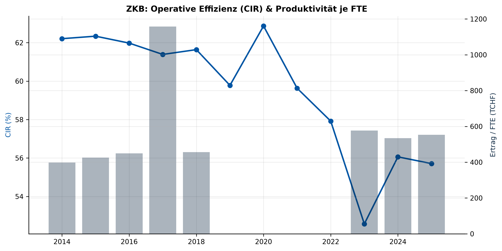

# 04 · Operative Effizienz & Transformation (2014–2025): Zürcher Kantonalbank

## 1. Management Summary
- Die Cost-Income-Ratio (CIR) liegt im Jahr 2025 bei **55,71 %** (vs. 62,21 % im Jahr 2014), die Eigenkapitalrendite (ROE) bei **51,18 %**.
- Der Personalbestand umfasst 2025 **5'809,0 FTE** bei einem Ertrag pro Vollzeitstelle von **553,1 TCHF**.

## 2. Quantitative Entwicklung
| Jahr | CIR % | ROE % | FTE | Ertrag/FTE (TCHF) | Bilanz/FTE (Mio.) | Filialen |
| --- | --- | --- | --- | --- | --- | --- |
| 2014 | 62,21 % | 9,35 % | 4'844,0 | 398,2 | 32,70 | 97 |
| 2015 | 62,34 % | 37,51 % | 5'179,0 | 425,6 | 29,81 | 91 |
| 2016 | 61,98 % | 28,49 % | 5'173,0 | 449,4 | 30,54 | 89 |
| 2017 | 61,39 % | – % | 2'017,0 | 1'158,2 | 81,25 | 78 |
| 2018 | 61,64 % | – % | 5'087,0 | 456,1 | 33,30 | 75 |
| 2019 | 59,78 % | – % | 5'145,0 | 0,5 | 32,47 | 66 |
| 2020 | 62,87 % | – % | 5'180,0 | 0,5 | 36,36 | 60 |
| 2021 | 59,63 % | – % | 5'145,0 | 0,5 | 37,34 | 57 |
| 2022 | 57,92 % | 11,56 % | 5'249,0 | 0,5 | 38,06 | 53 |
| 2023 | 52,57 % | 51,05 % | 5'539,0 | 576,6 | 36,33 | 53 |
| 2024 | 56,06 % | 10,94 % | 5'779,0 | 534,3 | 35,06 | – |
| 2025 | 55,71 % | 51,18 % | 5'809,0 | 553,1 | 35,49 | 51 |

## 3. Treiberanalyse & Wendepunkte
- **2015:** Übernahme Swisscanto & FINMA-RVB
- **2024:** AuM-Umklassierung Custody Services (-55 Mrd. CHF) & OECD-Mindeststeuer
- **2025:** Inkrafttreten Basel III final per 01.01.2025

## 4. Fazit & Ausblick
- Digitalisierung und Skalierung steigern Bilanzsumme und Geschäftsvolumen pro Vollzeitstelle langfristig.
