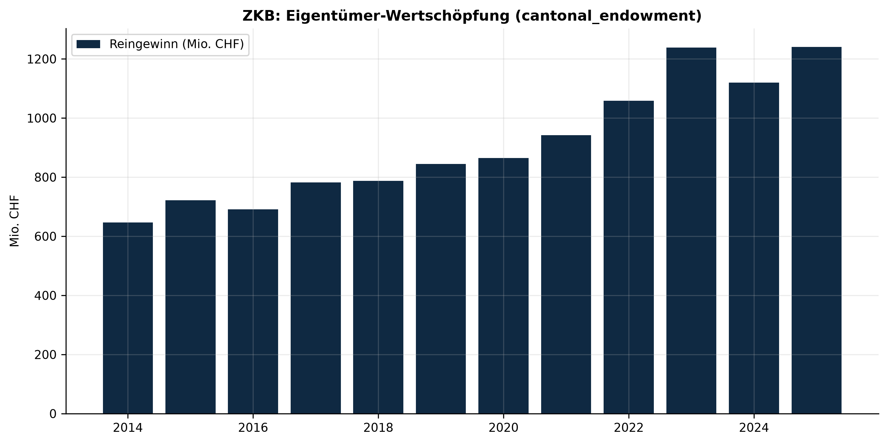

# 05 · Dotationskapital, Ausschüttung & Kanton (2014–2025): Zürcher Kantonalbank

> **Eigentümer-Modus:** `cantonal_endowment` | **Staatsgarantie:** Ja | **Ticker:** `nicht kotiert`

## 1. Management Summary
- Im Geschäftsjahr 2025 erwirtschaftete ZKB einen Gewinn von **1'241,0 Mio. CHF** bei einem Eigenkapital von **2'425,0 Mio. CHF**.
- Die Ausschüttungs- und Kapitalstruktur folgt dem spezifischen Governance-Modell (`cantonal_endowment`).

## 2. Quantitative Entwicklung
| Jahr | Reingewinn (Mio.) | Eigenkapital (Mio.) | Aktienkurs (split-ber.) | Dividende/Aktie | Div.-Rendite | Öff. Ablieferung (Mio.) |
| --- | --- | --- | --- | --- | --- | --- |
| 2014 | 647,0 | 6'919,0 | – | – | – % | – |
| 2015 | 722,0 | 1'925,0 | – | – | – % | – |
| 2016 | 691,0 | 2'425,0 | – | – | – % | – |
| 2017 | 782,0 | – | – | – | – % | – |
| 2018 | 788,0 | – | – | – | – % | – |
| 2019 | 845,0 | – | – | – | – % | – |
| 2020 | 865,0 | – | – | – | – % | – |
| 2021 | 942,0 | – | – | – | – % | – |
| 2022 | 1'059,0 | 9'163,0 | – | – | – % | – |
| 2023 | 1'238,0 | 2'425,0 | – | – | – % | – |
| 2024 | 1'120,0 | 10'241,0 | – | – | – % | – |
| 2025 | 1'241,0 | 2'425,0 | – | – | – % | – |

## 3. Treiberanalyse & Wendepunkte
- Bei kotierten Instituten mit Aktiensplits (z. B. BCV 1:10 im Jahr 2020) sind sämtliche historischen Kurs- und Dividendenreihen deterministisch split-bereinigt.

## 4. Fazit & Ausblick
- Stabile Ertragskraft sichert langfristig Dividendenkontinuität bzw. verlässliche Ablieferungen an Kanton, Post oder Genossenschafter.
